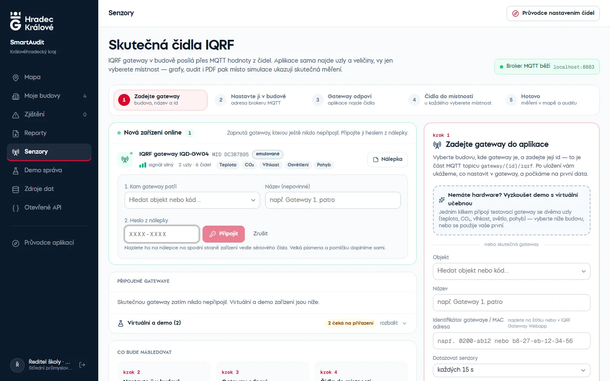
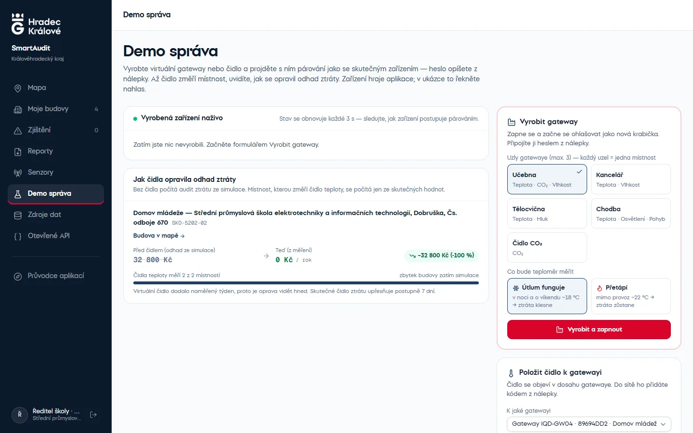
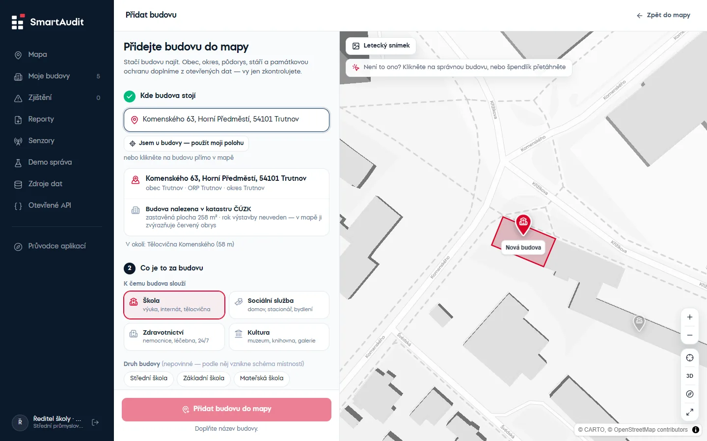
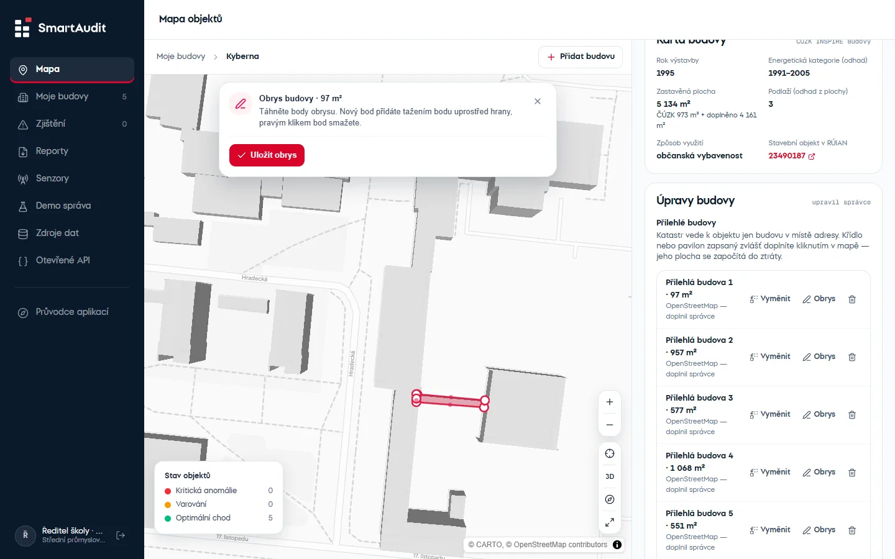

# 🏢 SmartAudit KHK

> **Energetický audit a inteligentní monitoring budov Královéhradeckého kraje.**  
> Aplikace propojující 25+ sad otevřených dat (Data KHK), katastr nemovitostí (ČÚZK INSPIRE WFS), adresy RÚIAN, Registr smluv, meteorologická data (Open-Meteo), AI analýzy (Azure OpenAI) a senzorovou telemetrii IQRF.

---

## 📸 Ukázky rozhraní

Snímky generuje `tools/screenshots/capture.py` (Playwright) — stejné obrázky používá landing page.

### 🗺️ Mapa kraje a okresy
*Okresy obarvené podle podílu budov se zjištěním, špendlíky podle stavu a druhu budovy:*


### 🏢 3D budova a inspekční panel
*Klik na špendlík přiblíží budovu ve 3D (půdorys ČÚZK v barvě stavu), panel ukáže telemetrii a místnosti:*


*Zjištění auditu a AI analýza (Azure OpenAI):*


### 📡 Skutečná čidla IQRF
*Gateway se připojí přes MQTT, aplikace sama najde uzly a senzory, správce přiřadí místnost:*


### 🔑 Párování nové gatewaye
*Zapnutá gateway se sama ohlásí v „Nových zařízeních online“ — správce vybere budovu a opíše heslo z nálepky:*



### 🧪 Demo správa
*Virtuální gatewaye a čidla k párování a přehled, jak skutečné měření opravilo odhad ztráty:*



### 🏗️ Vlastní budovy správce
*Přidání budovy přes adresu RÚIAN — obec, okres i půdorys z katastru se doplní samy:*



*Úprava obrysu přilehlé budovy přímo v mapě (plocha se započítá do ztráty):*



### 📄 PDF audit


### 👪 Pro veřejnost — „Jak se dýchá ve škole?“
*Veřejná karta objektu bez přihlášení (kvalita vzduchu, místnosti, kdy větrat) a QR kód na dveře:*


### 🌐 Otevřené API


---

## 🚀 Rychlé spuštění (Docker)

```bash
docker compose up --build
```

### Přístupné služby:

| Služba | URL | Popis |
|---|---|---|
| **Landing page** | [http://localhost:3000](http://localhost:3000) | Představení aplikace, vstup do dema |
| **Aplikace (mapa)** | [http://localhost:3000/mapa](http://localhost:3000/mapa) | Po přihlášení (tlačítka Demo) |
| **Demo správa** | [http://localhost:3000/demo](http://localhost:3000/demo) | Virtuální gatewaye a čidla k párování (kraj a správce) |
| **Pro veřejnost** | [http://localhost:3000/objekty](http://localhost:3000/objekty) | Najdi svou školu, kvalita vzduchu — bez přihlášení |
| **API Backend (ASP.NET)** | [http://localhost:8080](http://localhost:8080) | REST API backend |
| **Otevřené API Docs** | [http://localhost:3000/api/open/docs/](http://localhost:3000/api/open/docs/) | Interaktivní OpenAPI (Scalar) |
| **PostgreSQL / PostGIS** | `localhost:5432` | Databáze (`smartaudit` / `smartaudit`) |
| **MQTT broker (Mosquitto)** | `IP-počítače:8883` (TLS) | Připojení IQRF gateway — jen s účtem gatewaye; `localhost:1883` jen z tohoto počítače |

> ℹ️ **První spuštění:** Při prvním startu API automaticky stáhne otevřená data, sestaví portfolio objektů, dotáhne katastrální karty z ČÚZK, počasí z Open-Meteo a dopočítá 7 dní telemetrie. Trvá to zhruba 1 minutu, stav je vidět na `GET /health`.

Na přihlašovací stránce (`/login`) jsou tlačítka **Demo** pro dvě role: **Jsem z kraje** a **Spravuji budovu**. Veřejnost účet nepotřebuje — má portál `/objekty`.

Bez internetu se data načtou z lokálních snapshotů v `seed/opendata/`. Vlastní hesla a JWT tajemství lze nastavit v `.env` (vzor v `.env.example`), včetně `MQTT_PROVISIONING_PASSWORD` pro párování nových gatewayí (prázdné = párování vypnuté).

---

## ✨ Hlavní Funkce

- **📡 Skutečná čidla IQRF:** IQRF gateway se přes MQTT připojí k aplikaci, ta sama najde uzly a senzory (teplota, CO₂, vlhkost, osvětlení, hluk, pohyb…) a po přiřazení do místnosti nahradí simulaci skutečným měřením. Celý uzel jde do místnosti přiřadit jedním klikem („Přiřadit vše“), návod k připojení ukáže broker, uživatele a heslo jako tři karty ke zkopírování. Návod v [docs/SENZORY_IQRF.md](docs/SENZORY_IQRF.md), emulátor gatewaye v `tools/iqrf-emulator/`.
- **🔑 Párování zařízení jako u Wi-Fi:** nová gateway z výroby se ohlásí přes sdílený účet `provisioning` a objeví se v panelu „Nová zařízení online“; správce vybere budovu a opíše heslo z nálepky. Aplikace heslem zašifruje nabídku přihlašovacích údajů k brokeru (AES-GCM, klíč PBKDF2), takže heslo nejde po síti ani do databáze. Čidla v dosahu gatewaye se do sítě přidají z detailu gatewaye (u skutečného hardwaru kódem z nálepky). Python emulátor párování umí taky — nálepky vypíše `docker compose logs emulators`.
- **🧪 Demo správa (`/demo`):** výroba virtuálních gatewayí a čidel s nastaveným chováním (funguje útlum / přetápí i mimo provoz), se kterými se projde párování jako se skutečným zařízením. Přehled „Jak čidla opravila odhad ztráty“ ukáže u každé změřené budovy ztrátu před čidlem (simulace) a teď (měření).
- **🧭 Průvodce nastavením čidel:** interaktivní prohlídka na mapě, v Senzorech a v detailu gatewaye, která pokračuje napříč stránkami — testovací síť, připojení gatewaye, přiřazení uzlu a výsledek v mapě.
- **🏗️ Vlastní budovy správce (`/budovy/nova`):** správce přidá budovu své organizace sám — adresu najde našeptávač RÚIAN (nebo klik do mapy), obec, okres, památkovou ochranu a kartu budovy ČÚZK dopočítá aplikace stejně jako u importu a audit ji vyhodnotí do minuty. Na mapě pak může doplnit nebo vyměnit přilehlou budovu kliknutím na budovu v podkladu, ručně upravit obrys (tažení bodů, nový bod z hrany, pravý klik bod smaže) a opravit plochu, počet podlaží a rok výstavby, když ČÚZK nesedí — údaje z katastru zůstávají uložené vedle. Odkaz na úpravy je i v portfoliu.
- **🗺️ Mapa objektů kraje:** Šedý podklad (mapcn) ve dvou úrovních — na celém kraji bubliny okresů (prstenec = složení stavů, uprostřed počet objektů) a malé tečky objektů, okresy obarvené podle podílu objektů se zjištěním; klik na okres ho vybere a teprve pak se ukážou špendlíky jen z něj (barva = stav, ikona = druh). Špendlíky se ukážou i po ručním přiblížení. Na startu není vybraný žádný objekt; po kliknutí mapa přeletí k budově a ukáže ji ve 3D (vybraná budova „vyroste“ v barvě stavu, okolí zprůhlední). Výběr zruší křížek, klik do mapy nebo Esc. Hledání s našeptávačem (bez ohledu na diakritiku, „jicin“ najde Jičín) otevře objekt rovnou v mapě; správce má nad mapou seznam „Moje budovy“ seřazený podle závažnosti.
- **📋 Inspekční panel:** Přehled, telemetrie (grafy a „Místnosti teď“ s odznakem živého čidla), auditní zjištění a karta budovy ČÚZK. Schematický řez budovou je zatím skrytý (`FEATURES.buildingSection`).
- **📑 Smlouvy z Registru smluv:** záložka „Smlouvy“ (kraj a správce) ukáže smlouvy organizace podle IČO — dodávky tepla a energií, servis kotelen a MaR, zateplení a snížení energetické náročnosti — s originálním PDF z registru. Cena tepla vytažená ze smlouvy nahradí v auditu paušál a AI analýza doporučí uplatnit existující servisní smlouvu místo nové zakázky.
- **👪 Pro veřejnost (`/objekty`):** bez přihlášení — najdi svou školu nebo domov, přehled kvality vnitřního vzduchu (ne žebříček), veřejná karta objektu s CO₂ po místnostech, grafem za 24 h, radou kdy větrat a tím, co kraj v budově řeší (bez Kč). QR kód k vytištění na dveře třídy.
- **🏠 Landing page (`/`):** představení aplikace se snímky, živými čísly z otevřeného API a vstupem do dema.
- **⚡ Portfolio a Anomálie:** Přehledná tabulka (řazení podle každého sloupce) a seznam zjištění seřazený podle odhadované roční finanční ztráty v Kč. Správce vidí jen svoje budovy („Moje budovy“, „Zjištění“), veřejnost nemá v navigaci Senzory ani Demo správu.
- **📄 PDF reporty:** Audit jednoho objektu (s grafy a lokalizační mapkou), souhrnný přehled portfolia s mapou okresů a **souhrn pro Radu kraje na jednu stranu A4** (ztráta kraje, pět priorit, pilot IQRF s návratností, návrh usnesení).
- **📡 Testovací síť kraje bez hardwaru:** jedním klikem pět virtuálních IQRF gatewayí v pěti okresech (živá data celou skutečnou cestou MQTT), nebo Python cluster `docker compose --profile emulators up -d`.
- **🧭 Průvodce SmartAuditu (AI + RAG):** otázky vlastními slovy na mapě aplikace i pro veřejnost (`/objekty`, karta objektu, úvod). Odpovědi rovnou řídí mapu — vybere okres, očísluje nalezené objekty, otevře budovu ve 3D s inspekčním panelem — a přidají graf (pořadí objektů nebo průběh CO₂ a teploty za 48 h) a zdroje „Odkud to vím“. Pod kapotou: hybridní RAG nad znalostní bází (`backend/SmartAudit.Api/Resources/Guide/*.md` + katalog datových sad; BM25 + embeddingy OpenAI), nástroje nad živými daty (hledání objektů, souhrn okresů, detail objektu) se stejnými oprávněními jako aplikace (veřejnost nikdy nevidí Kč). Ochrana ve čtyřech vrstvách: filtry před modelem (pokusy o změnu pravidel, kód i „nejdřív napiš kód a pak…“, recepty a témata mimo účel), systémový prompt, kontrola odpovědi (kód, únik instrukcí přes kontrolní řetězec) a ověření, že každá částka v Kč pochází z dat. Bez AI klíče nebo při výpadku odpovídá záložní režim přímo z dat. Limit 15 dotazů za minutu na uživatele/IP.
- **🤖 AI analýza (Azure OpenAI):** Navrhne konkrétní opatření s vyčíslenou návratností a dopis správci. Výsledek se propisuje i do PDF auditního protokolu.
- **🌐 Otevřené API (`/api/open/v1`):** JSON, GeoJSON a CSV exporty pro vývojáře bez nutnosti přihlášení a API klíčů (licence CC BY 4.0).
  Lokální katalog **DCAT-AP-CZ** (`/api/open/v1/catalog`, JSON-LD podle OFN 2024-05-28) — adresu stačí zaregistrovat v Národním katalogu otevřených dat.

---

## ⚙️ Zapnutí AI analýzy (OpenAI nebo Azure OpenAI)

Do `.env` doplňte klíč od OpenAI (z platform.openai.com) a restartujte API:

```env
OPENAI_API_KEY=<klíč sk-…>
OPENAI_MODEL=gpt-4o
# embeddingy pro průvodce (RAG) — nepovinné, bez nich hledá průvodce ve znalostech podle slov
OPENAI_EMBEDDING_MODEL=text-embedding-3-small
```

Nebo přístupové údaje z Azure OpenAI — když jsou vyplněné, mají přednost:

```env
AZURE_OPENAI_ENDPOINT=https://<nazev-zdroje>.openai.azure.com/
AZURE_OPENAI_API_KEY=<klíč>
AZURE_OPENAI_DEPLOYMENT=<název nasazení, např. gpt-4o>
```

Bez nich aplikace běží normálně a karta AI analýzy informuje, jaké proměnné doplnit.

---

## 🏗️ Architektura a Struktura Repozitáře

```
web (Next.js :3000) ──/api/*──► api (ASP.NET net10 :8080) ──► db (PostgreSQL + PostGIS)
                                  ├─ DataPipelineService      stažení sad → portfolio → ČÚZK → počasí → (na pozadí) Registr smluv
                                  └─ SensorSimulationService  senzory → historie + živá data → audit
```

| Složka | Obsah |
|---|---|
| `backend/` | ASP.NET Core API (`SmartAudit.Api`) a doménová logika s EF Core (`SmartAudit.Core`) |
| `frontend/` | Next.js App Router (TypeScript, Tailwind CSS, shadcn/ui, MapLibre GL) |
| `seed/opendata/` | Snapshoty otevřených dat pro offline start |
| `docs/` | Dokumentace (`SMARTAUDIT_FUNKCE.md`) a obrázky (`docs/images/`) |
| `research/` | Rešerše 165 sad Data KHK, analýzy v Pythonu a datové manifesty |

---

## 💻 Lokální vývoj bez Dockeru

```bash
docker compose up -d db mqtt
dotnet run --project backend/SmartAudit.Api --launch-profile http
npm --prefix frontend run dev
```

Testy backendu (výpočet ztráty, přihlašovací údaje gatewaye, parser IQRF, párování, Registr smluv, adresy RÚIAN, plochy obrysů, demo zařízení):

```bash
dotnet test backend/SmartAudit.slnx
```

Frontend čeká API na `http://localhost:5033` (proměnná `API_INTERNAL_URL`).

Nová migrace databáze:

```bash
dotnet ef migrations add <Nazev> --project backend/SmartAudit.Core --startup-project backend/SmartAudit.Api
```

---

## 📡 Simulace telemetrie

Senzory jsou generovány deterministickým modelem `SensorSimulator`. Vstupy bere z reálné venkovní teploty (Open-Meteo), stáří a plochy budovy (ČÚZK), počtu žáků/klientů (Data KHK) a kalendáře svátků. Zhruba 30 % objektů má simulační profil s problémem (víkendové přetápění, špatné větrání, nefunkční noční útlum). Audit (`FacilityStatusEvaluator`) tyto problémy detekuje pravidly nad naměřenými daty.

Jakmile místnost měří skutečné čidlo IQRF, simulace pro ni skončí a audit počítá se skutečnými hodnotami — viz [docs/SENZORY_IQRF.md](docs/SENZORY_IQRF.md).

**Odhad ztráty v Kč** vychází z naměřené teploty, ne ze simulačního profilu: za každou hodinu přetápění mimo provoz
(víkend nebo noc bez útlumu) se sečte tepelná ztráta budovy × (naměřená teplota − útlum 18 °C, u domovů a nemocnic 20 °C).
Tepelná ztráta budovy = podlahová plocha × měrná ztráta podle roku výstavby (ČÚZK, případně oprava správce — plocha, podlaží, rok výstavby a doplněné přilehlé budovy). Týden se přepočte na topnou sezónu
(33 týdnů) a cenu tepla 2,20 Kč/kWh (`AuditSettings`). Ukáže-li skutečné čidlo útlum, ztráta klesne na nulu (test v `SmartAudit.Tests`).

**Cena tepla ze smlouvy:** po startu stáhne `ContractSyncService` na pozadí z [Registru smluv](https://smlouvy.gov.cz) smlouvy
všech organizací kraje podle IČO (vyhledávání podle předmětu, ~18 dotazů na organizaci s odstupem 1 s; registr nemá
vyhledávací REST API, čte se HTML podrobného vyhledávání). U smluv na dodávku tepla a plynu přečte PDF a DOCX přílohy
a najde cenu (Kč/GJ, Kč/MWh). Má-li organizace cenu tepla (nebo plynu, přepočet přes účinnost kotle 90 %), audit ji použije
místo paušálu; cenu elektřiny ne. Elektřinu a plyn nakupuje kraj centrálně na komoditní burze, takže u většiny škol zůstává
paušál — silná stránka integrace jsou servisní smlouvy na MaR a kotelny a proběhlé stavby. Poslední stav je
v `seed/opendata/registr-smluv.json` (start bez sítě), obnova po 7 dnech (`ContractRegistrySettings`).

**Výkon a škálování:**
- Tabulka měření `SensorReadings` je rozdělená na **měsíční oddíly** (PostgreSQL partitioning) s indexem BRIN nad časem. Dotazy na posledních 7 dní čtou jen poslední oddíly a staré měsíce jde odpojit a archivovat bez mazání řádek po řádku.
- Audit se přepočítává **inkrementálně**: nový krok simulace (15 min) přepočte kraj, měření ze skutečného čidla jen jeho budovu (řádově desítky ms místo stovek).
- Měření z jedné odpovědi gatewaye se ukládají **jedním příkazem** (`INSERT … SELECT FROM unnest(…)`), simulace hromadně přes binární `COPY`.
