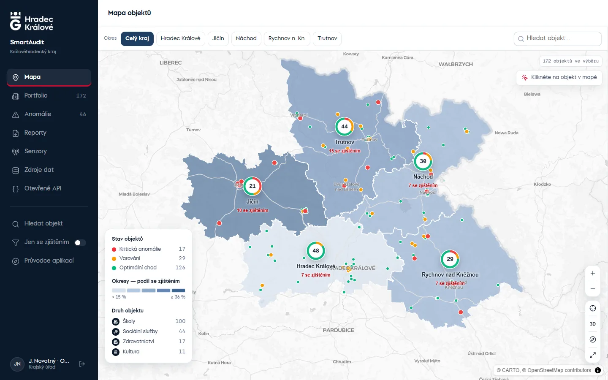
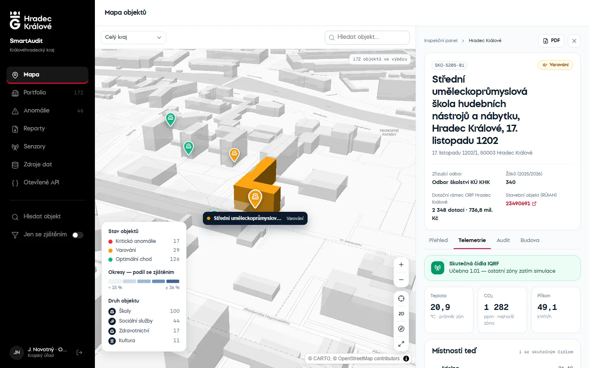
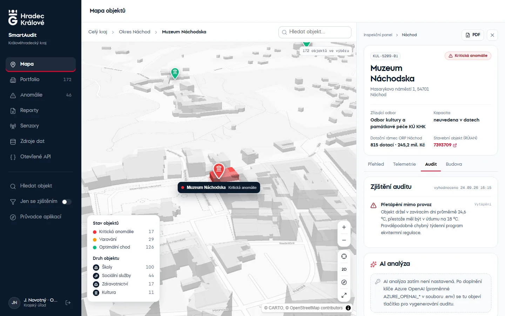
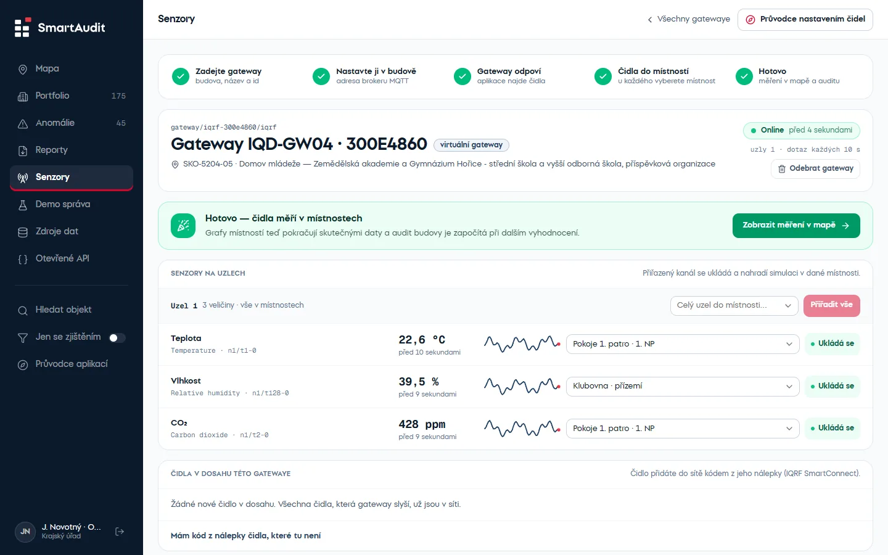
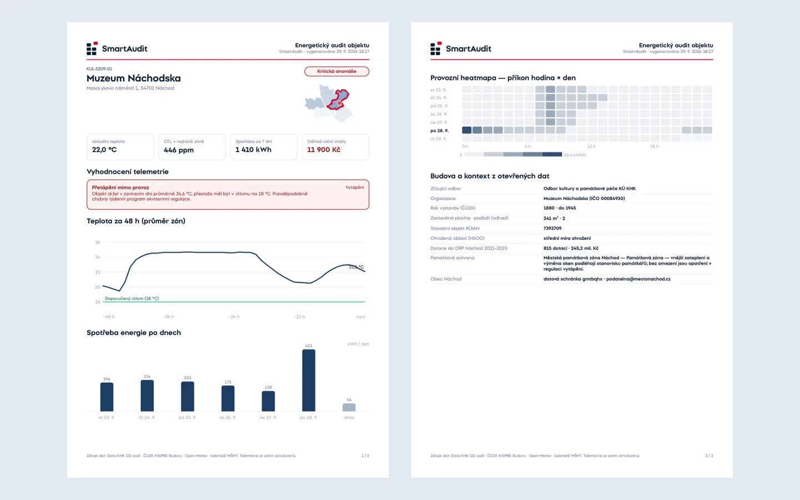
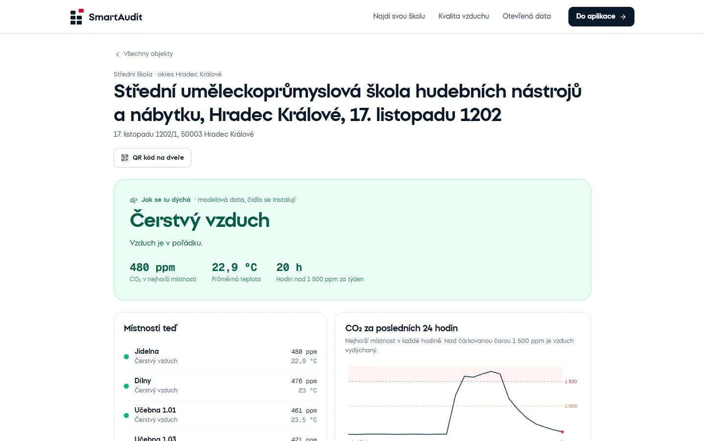
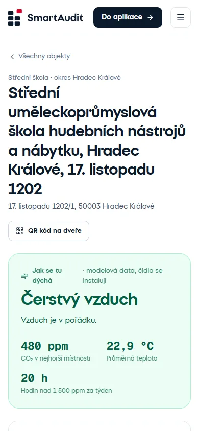
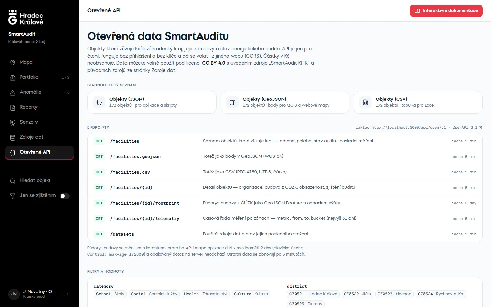

# 🏢 SmartAudit KHK

> **Energetický audit a inteligentní monitoring budov Královéhradeckého kraje.**  
> Aplikace propojující 25+ sad otevřených dat (Data KHK), katastr nemovitostí (ČÚZK INSPIRE WFS), meteorologická data (Open-Meteo), AI analýzy (Azure OpenAI) a senzorovou telemetrii.

---

## 📸 Ukázky rozhraní

Snímky generuje `tools/screenshots/capture.py` (Playwright) — stejné obrázky používá landing page.

### 🗺️ Mapa kraje a okresy
*Okresy obarvené podle podílu budov se zjištěním, špendlíky podle stavu a druhu budovy:*



### 🏢 3D budova a inspekční panel
*Klik na špendlík přiblíží budovu ve 3D (půdorys ČÚZK v barvě stavu), panel ukáže telemetrii a místnosti:*



*Zjištění auditu a AI analýza (Azure OpenAI):*



### 📡 Skutečná čidla IQRF
*Gateway se připojí přes MQTT, aplikace sama najde uzly a senzory, správce přiřadí místnost:*



### 📄 PDF audit


### 👪 Pro veřejnost — „Jak se dýchá ve škole?“
*Veřejná karta objektu bez přihlášení (kvalita vzduchu, místnosti, kdy větrat) a QR kód na dveře:*





### 🌐 Otevřené API


---

## 🚀 Rychlé spuštění (Docker)

```bash
docker compose up --build
```

### Přístupné služby:

| Služba | URL | Popis |
|---|---|---|
| **Landing page** | [http://localhost:3000](http://localhost:3000) | Představení aplikace, vstup do dema |
| **Aplikace (mapa)** | [http://localhost:3000/mapa](http://localhost:3000/mapa) | Po přihlášení (tlačítka Demo) |
| **Pro veřejnost** | [http://localhost:3000/objekty](http://localhost:3000/objekty) | Najdi svou školu, kvalita vzduchu — bez přihlášení |
| **API Backend (ASP.NET)** | [http://localhost:8080](http://localhost:8080) | REST API backend |
| **Otevřené API Docs** | [http://localhost:3000/api/open/docs/](http://localhost:3000/api/open/docs/) | Interaktivní OpenAPI (Scalar) |
| **PostgreSQL / PostGIS** | `localhost:5432` | Databáze (`smartaudit` / `smartaudit`) |
| **MQTT broker (Mosquitto)** | `localhost:1883` | Připojení IQRF gateway (skutečná čidla) |

> ℹ️ **První spuštění:** Při prvním startu API automaticky stáhne otevřená data, sestaví portfolio objektů, dotáhne katastrální karty z ČÚZK, počasí z Open-Meteo a dopočítá 7 dní telemetrie. Trvá to zhruba 1 minutu, stav je vidět na `GET /health`.

Na přihlašovací stránce (`/login`) jsou tlačítka **Demo** pro tři role: **Kraj**, **Správce budovy** a **Veřejnost**.

Bez internetu se data načtou z lokálních snapshotů v `seed/opendata/`. Vlastní hesla a JWT tajemství lze nastavit v `.env` (vzor v `.env.example`).

---

## ✨ Hlavní Funkce

- **📡 Skutečná čidla IQRF:** IQRF gateway se přes MQTT připojí k aplikaci, ta sama najde uzly a senzory (teplota, CO₂, vlhkost, osvětlení, hluk, pohyb…) a po přiřazení do místnosti nahradí simulaci skutečným měřením. Návod v [docs/SENZORY_IQRF.md](docs/SENZORY_IQRF.md), emulátor gatewaye v `tools/iqrf-emulator/`.
- **🗺️ Mapa objektů kraje:** Šedý podklad (mapcn) ve dvou úrovních — na celém kraji štítky okresů (počet objektů, kritické a varování) a malé tečky objektů, okresy obarvené podle podílu objektů se zjištěním; klik na okres ho vybere a teprve pak se ukážou špendlíky jen z něj (barva = stav, ikona = druh). Špendlíky se ukážou i po ručním přiblížení. Na startu není vybraný žádný objekt; po kliknutí mapa přeletí k budově a ukáže ji ve 3D (vybraná budova „vyroste“ v barvě stavu, okolí zprůhlední). Výběr zruší křížek, klik do mapy nebo Esc.
- **📋 Inspekční panel:** Přehled, telemetrie (grafy a „Místnosti teď“ s odznakem živého čidla), auditní zjištění a karta budovy ČÚZK. Schematický řez budovou je zatím skrytý (`FEATURES.buildingSection`).
- **👪 Pro veřejnost (`/objekty`):** bez přihlášení — najdi svou školu nebo domov, přehled kvality vnitřního vzduchu (ne žebříček), veřejná karta objektu s CO₂ po místnostech, grafem za 24 h, radou kdy větrat a tím, co kraj v budově řeší (bez Kč). QR kód k vytištění na dveře třídy.
- **🏠 Landing page (`/`):** představení aplikace se snímky, živými čísly z otevřeného API a vstupem do dema.
- **⚡ Portfolio a Anomálie:** Přehledná tabulka a seznam zjištění seřazený podle odhadované roční finanční ztráty v Kč.
- **📄 PDF reporty:** Audit jednoho objektu (s grafy a lokalizační mapkou) i souhrnný přehled portfolia s mapou okresů.
- **🤖 AI analýza (Azure OpenAI):** Navrhne konkrétní opatření s vyčíslenou návratností a dopis správci. Výsledek se propisuje i do PDF auditního protokolu.
- **🌐 Otevřené API (`/api/open/v1`):** JSON, GeoJSON a CSV exporty pro vývojáře bez nutnosti přihlášení a API klíčů (licence CC BY 4.0).

---

## ⚙️ Zapnutí AI analýzy (Azure OpenAI)

Do `.env` doplňte přístupové údaje z Azure OpenAI a restartujte API:

```env
AZURE_OPENAI_ENDPOINT=https://<nazev-zdroje>.openai.azure.com/
AZURE_OPENAI_API_KEY=<klíč>
AZURE_OPENAI_DEPLOYMENT=<název nasazení, např. gpt-4o>
```

Bez nich aplikace běží normálně a karta AI analýzy informuje, jaké proměnné doplnit.

---

## 🏗️ Architektura a Struktura Repozitáře

```
web (Next.js :3000) ──/api/*──► api (ASP.NET net10 :8080) ──► db (PostgreSQL + PostGIS)
                                  ├─ DataPipelineService      stažení sad → portfolio → ČÚZK → počasí
                                  └─ SensorSimulationService  senzory → historie + živá data → audit
```

| Složka | Obsah |
|---|---|
| `backend/` | ASP.NET Core API (`SmartAudit.Api`) a doménová logika s EF Core (`SmartAudit.Core`) |
| `frontend/` | Next.js App Router (TypeScript, Tailwind CSS, shadcn/ui, MapLibre GL) |
| `seed/opendata/` | Snapshoty otevřených dat pro offline start |
| `docs/` | Dokumentace (`SMARTAUDIT_FUNKCE.md`) a obrázky (`docs/images/`) |
| `research/` | Rešerše 165 sad Data KHK, analýzy v Pythonu a datové manifesty |

---

## 💻 Lokální vývoj bez Dockeru

```bash
docker compose up -d db
dotnet run --project backend/SmartAudit.Api --launch-profile http
npm --prefix frontend run dev
```

Frontend čeká API na `http://localhost:5033` (proměnná `API_INTERNAL_URL`).

Nová migrace databáze:

```bash
dotnet ef migrations add <Nazev> --project backend/SmartAudit.Core --startup-project backend/SmartAudit.Api
```

---

## 📡 Simulace telemetrie

Senzory jsou generovány deterministickým modelem `SensorSimulator`. Vstupy bere z reálné venkovní teploty (Open-Meteo), stáří a plochy budovy (ČÚZK), počtu žáků/klientů (Data KHK) a kalendáře svátků. Zhruba 30 % objektů má simulační profil s problémem (víkendové přetápění, špatné větrání, nefunkční noční útlum). Audit (`FacilityStatusEvaluator`) tyto problémy detekuje pravidly nad naměřenými daty.

Jakmile místnost měří skutečné čidlo IQRF, simulace pro ni skončí a audit počítá se skutečnými hodnotami — viz [docs/SENZORY_IQRF.md](docs/SENZORY_IQRF.md).
