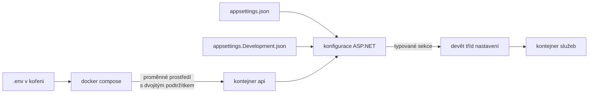
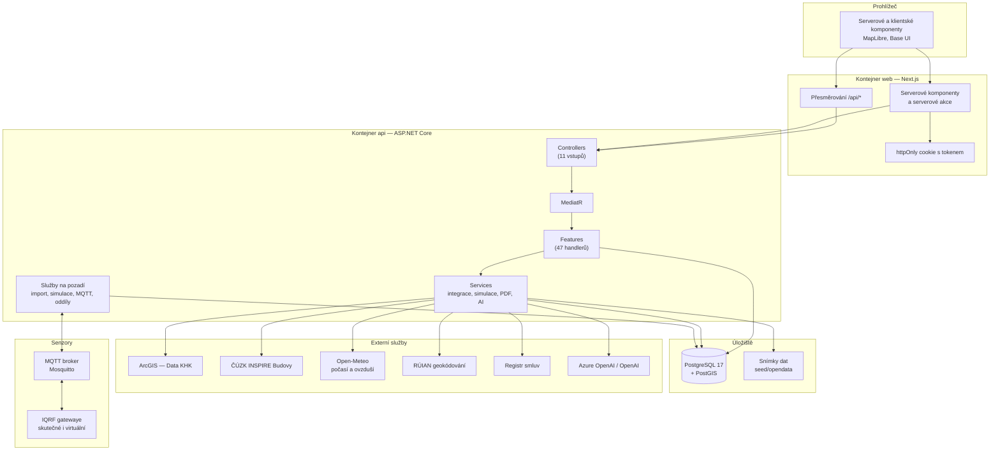

# 01 — Architektura a infrastruktura

> **Protokol nulového úniku kódu.** Tento dokument neobsahuje žádný řádek zdrojového kódu
> aplikace. Mechanismy jsou popsány procedurálně, strukturou a diagramy.

Aplikace: **SmartAudit KHK** — energetický audit budov zřizovaných Královéhradeckým krajem
nad otevřenými daty, s napojením na skutečná IQRF čidla.

Rozsah analyzované codebase: **386 zdrojových souborů, 40 245 řádků**
(234 × C#, 152 × TypeScript/TSX), bez generovaných migračních `*.Designer.cs`.

---

## 1. Technologický inventář

### 1.1 Rozdělení na běhové jednotky

Systém běží jako **pět kontejnerů** řízených jedním compose souborem; dva z nich jsou
volitelné a zapínají se profilem.

| Služba | Obraz / sestavení | Port (hostitel) | Role |
|---|---|---|---|
| `db` | `postgis/postgis:17-3.5` | `127.0.0.1:5432` | PostgreSQL 17 s rozšířením PostGIS — jediné trvalé úložiště |
| `mqtt` | vlastní sestavení z `./mqtt` | `127.0.0.1:1883`, `0.0.0.0:8883` | Mosquitto broker; 1883 nešifrovaně jen lokálně, 8883 TLS pro gatewaye v síti |
| `api` | vlastní sestavení z `./backend` | `127.0.0.1:8080` | ASP.NET Core — doména, data, integrace, PDF, MQTT |
| `web` | vlastní sestavení z `./frontend` | `0.0.0.0:3000` | Next.js — jediná veřejně vystavená služba, přeposílá `/api/*` na `api` |
| `emulator` | `python:3.12-slim`, profil `emulator` | — | Jedna emulovaná IQRF gateway |
| `emulators` | vlastní sestavení, profil `emulators` | — | Pět emulovaných gatewayí v pěti okresech + zařízení k párování |

**Zásadní bezpečnostní rozhodnutí v topologii:** API ani databáze nejsou vystavené do sítě.
Ven jde pouze web na portu 3000 a MQTT TLS na 8883. Prohlížeč nikdy nemluví s API přímo —
Next.js server dělá reverzní proxy, takže v klientském balíčku není adresa API ani není
potřeba CORS pro aplikaci samotnou.

### 1.2 Backend — produkční závislosti

Cílová platforma **.NET 10** (`net10.0`), `Nullable=enable`, `ImplicitUsings=enable`.
Řešení má tři projekty: `SmartAudit.Api`, `SmartAudit.Core`, `SmartAudit.Tests`.

#### SmartAudit.Api

| Balíček | Verze | K čemu v této aplikaci slouží | Proč byl zvolen |
|---|---|---|---|
| `MediatR` | 14.2.0 | Nosník vertical-slice architektury: každý případ užití je samostatný handler, controller jen předá příkaz | Oddělí HTTP vrstvu od logiky bez vrstvy „services" plné metod; 47 handlerů nemá vzájemné závislosti |
| `Microsoft.AspNetCore.Authentication.JwtBearer` | 10.0.11 | Ověření JWT tokenu, mapování rolí a nároku organizace | Stateless autentizace — API nedrží session, škáluje a snese restart |
| `Microsoft.AspNetCore.OpenApi` | 10.0.12 | Generování dvou oddělených OpenAPI dokumentů (veřejné otevřené API, interní API) | Veřejné API musí mít dokumentaci i v produkci, interní jen při vývoji |
| `Scalar.AspNetCore` | 2.17.2 | Vykreslení dokumentace na `/api/open/docs` | Modernější a čitelnější než Swagger UI; umí více dokumentů v jednom přepínači |
| `Microsoft.EntityFrameworkCore.Design` | 10.0.11 | Návrhový čas — generování migrací | Pouze nástroj, `PrivateAssets=all` |
| `Microsoft.IdentityModel.Tokens` + `System.IdentityModel.Tokens.Jwt` | 8.22.0 | Podpis a validace tokenů symetrickým klíčem | — |
| `MQTTnet` | 5.2.0.1603 | Klient k brokeru: příjem telemetrie z gatewayí, odesílání příkazů, správa účtů přes Dynamic Security | Jediná vyzrálá MQTT knihovna pro .NET s podporou v5 a TLS |
| `NetTopologySuite.IO.GeoJSON4STJ` | 4.0.0 | Serializace geometrie (bod objektu, půdorys budovy, hranice regionů) do GeoJSON přímo v `System.Text.Json` | Mapa na frontendu konzumuje GeoJSON; bez tohoto by se geometrie musela převádět ručně |
| `QuestPDF` | 2026.9.0 | Tři druhy PDF reportů (objekt, portfolio, souhrn pro Radu kraje) | Deklarativní rozvržení; licence Community pro malé organizace |
| `PdfPig` | 0.1.16 | Čtení textu z příloh smluv v Registru smluv — hledá se v nich cena energie | Bez závislosti na nativních knihovnách, funguje v kontejneru |
| `Azure.AI.OpenAI` | 2.1.0 | Klient pro Azure OpenAI i pro OpenAI (sjednocené rozhraní) | Jedna knihovna pro oba poskytovatele; aplikace mezi nimi přepíná podle konfigurace |

#### SmartAudit.Core

| Balíček | Verze | Účel |
|---|---|---|
| `Microsoft.EntityFrameworkCore` + `.Relational` | 10.0.11 | ORM, konfigurace entit, migrace |
| `Npgsql.EntityFrameworkCore.PostgreSQL` | 10.0.3 | Poskytovatel pro PostgreSQL |
| `Npgsql.EntityFrameworkCore.PostgreSQL.NetTopologySuite` | 10.0.3 | Mapování geometrických typů na PostGIS |
| `BCrypt.Net-Next` | 4.2.0 | Hashování hesel uživatelů |

#### SmartAudit.Tests

| Balíček | Verze | Účel |
|---|---|---|
| `xunit` | 2.9.3 | Testovací rámec |
| `xunit.runner.visualstudio` | 3.1.4 | Integrace běhu testů |
| `Microsoft.NET.Test.Sdk` | 17.14.1 | Hostitel testů |
| `coverlet.collector` | 6.0.4 | Měření pokrytí |

> Testovací projekt odkazuje **pouze na `SmartAudit.Core`**, nikoli na `Api`. Testy tedy
> pokrývají doménová pravidla a pomocné výpočty, ne HTTP vrstvu ani handlery.

### 1.3 Frontend — produkční závislosti

| Balíček | Verze | K čemu slouží | Proč byl zvolen |
|---|---|---|---|
| `next` | 16.3.6 | Aplikační rámec, App Router, serverové komponenty, serverové akce, reverzní proxy na API | Serverové vykreslování znamená, že JWT zůstane v httpOnly cookie a nikdy se nedostane do klientského JS |
| `react` / `react-dom` | 19.2.8 | Vykreslovací knihovna | — |
| `maplibre-gl` | 6.11.0 | Vektorová mapa kraje, vrstvy okresů, špendlíky objektů, půdorysy a 3D extruze budovy | Otevřená alternativa k Mapboxu bez klíče a bez poplatků |
| `@base-ui/react` | 1.8.0 | Nestylované přístupné primitivy (select, checkbox, combobox) | Dodává chování a přístupnost; vzhled si určuje aplikace |
| `shadcn` | 4.21.0 | Zdroj komponentních vzorů a základní Tailwind vrstvy | Komponenty jsou v repu jako vlastní soubory, ne jako závislost — lze je upravovat |
| `class-variance-authority` | 0.7.1 | Definice variant komponent (druh, velikost) nad třídami | Typově bezpečné varianty místo řetězení podmínek |
| `cn` | 0.4.0 | Slučování tříd | — |
| `lucide-react` | 1.47.0 | Ikonová sada | Konzistentní tah, stromově odstranitelné |
| `qrcode` | 1.5.4 | Generování QR kódu na veřejnou stránku objektu (tisk pro školu) | — |
| `tw-animate-css` | 1.4.0 | Doplňkové animace pro Tailwind v4 | — |
| `server-only` | 0.0.1 | Pojistka, že modul nikdy neskončí v klientském balíčku | Chrání moduly, které čtou tajemství a cookies |

#### Vývojové závislosti

| Balíček | Verze | Účel |
|---|---|---|
| `typescript` | ^5 | Typová kontrola, `strict: true` |
| `tailwindcss` + `@tailwindcss/postcss` | ^4 | Utility CSS, konfigurace v CSS (ne v JS) |
| `eslint` + `eslint-config-next` | ^9 / 16.3.6 | Statická kontrola |
| `playwright` | 1.63.0 | Automatizace prohlížeče (podklady pro video, nikoli testy aplikace) |
| `@types/*` | — | Typy pro `node`, `react`, `react-dom`, `geojson`, `qrcode` |

### 1.4 Nástroje sestavení a kontroly

| Oblast | Nástroj | Nastavení |
|---|---|---|
| Backend build | .NET SDK 10 | Vícefázový Dockerfile: `restore` nad samotnými projektovými soubory (cache), pak `publish -c Release` |
| Backend běh | `mcr.microsoft.com/dotnet/aspnet:10.0` | Poslouchá na 8080, jen HTTP (TLS řeší proxy) |
| Backend dokumentace | `GenerateDocumentationFile=true` | XML komentáře controllerů se propisují do OpenAPI; potlačeny varování 1591 a 1573 |
| Frontend build | Next.js, výstup `standalone` | Třífázový Dockerfile: `deps` (`npm ci`) → `build` → `runtime` |
| Frontend běh | `node:22-alpine`, uživatel `node` | Port 3000, `HOSTNAME=0.0.0.0`, telemetrie vypnutá |
| TypeScript | `tsconfig.json` | `strict: true`, `noEmit`, `moduleResolution: bundler`, alias `@/*` → kořen |
| Linter | ESLint 9 s `eslint-config-next` | Spouští se příkazem `lint` |
| Formátování | — | **V repu není konfigurace Prettieru ani `.editorconfig`.** Formátování drží konvence jazyka a nástroje IDE |

> **Zjištění pro reimplementaci:** absence formátovacího nástroje je stav původní codebase,
> ne opomenutí analýzy. Doporučení pro nový projekt je v dokumentu `04`.

---

## 2. Topologie adresářové struktury

```
/
├── backend/                      Řešení .NET (tři projekty)
│   ├── SmartAudit.Api/           Spustitelná webová aplikace
│   │   ├── Controllers/          Tenké HTTP vstupy (11 souborů) — jen předání příkazu a mapování odpovědi
│   │   ├── Features/             Vertical slices (47 handlerů) — jeden adresář = jeden případ užití
│   │   ├── Services/             Dlouhožijící a sdílená logika (integrace, simulace, MQTT, PDF, AI)
│   │   ├── Middleware/           Globální zachycení výjimek
│   │   ├── Extentions/           Rozšiřující metody nad HTTP kontextem a odpovědí
│   │   ├── Resources/            Netextové zdroje — písma, logo, znalosti průvodce
│   │   └── Properties/           Profily spuštění pro vývoj
│   ├── SmartAudit.Core/          Knihovna bez znalosti HTTP
│   │   ├── Data/Tables/          Entity (21) — zapouzdřené, privátní settery
│   │   ├── Data/EntityConfigurations/  Mapování entit na schéma
│   │   ├── Domain/Enums/         Číselníky domény (13)
│   │   ├── Domain/Settings/      Typované konfigurační sekce (9)
│   │   ├── Domain/Helpers/       Čisté výpočty a převody
│   │   └── Migrations/           Historie schématu
│   └── SmartAudit.Tests/         Testy domény a pomocných výpočtů
├── frontend/                     Next.js aplikace
│   ├── app/(app)/                Přihlášená část — mapa, portfolio, senzory, reporty
│   ├── app/(public)/             Veřejná část bez přihlášení — objekty, QR
│   ├── app/login/                Přihlášení a demo účty
│   ├── app/fonts/                Firemní písmo Hradce Králové
│   ├── components/ui/            Obecné stavební prvky rozhraní
│   ├── components/guide/         Panel průvodce (AI)
│   ├── components/brand/         Značkové prvky (symbol, načítání)
│   ├── lib/                      Klient API, pomocné výpočty, metadata
│   └── types/                    Sdílené typy odpovědí API
├── mqtt/                         Sestavení Mosquitto brokeru a jeho konfigurace
├── tools/iqrf-emulator/          Emulátor IQRF gatewayí v Pythonu
├── seed/opendata/                Snímky otevřených dat pro start bez sítě
├── design/                       Logo, barvy, podklady vizuálního stylu
├── docs/                         Provozní a funkční dokumentace
├── research/                     Průzkum otevřených dat (katalog, skripty, kontext)
└── analyza/                      Tento adresář — specifikace pro reimplementaci
```

### 2.1 Proč je struktura rozdělená právě takto

**Controllers vs. Features.** Controller nedělá nic než převzetí HTTP požadavku, sestavení
příkazu a převedení výsledku na HTTP odpověď. Veškerá logika je v handleru ve `Features`.
Důvod: jeden případ užití se dá přečíst v jednom souboru bez skákání po vrstvách a změna
jednoho chování nemůže rozbít jiné.

**Features vs. Services.** Do `Features` patří logika, která obsluhuje **jeden konkrétní
požadavek uživatele**. Do `Services` patří to, co **žije déle než požadavek** nebo co
sdílí více handlerů: připojení k brokeru, běžící simulace, import dat, sestavení PDF,
klient k AI. Služby na pozadí jsou registrované jako hostované.

**Api vs. Core.** `Core` neví nic o HTTP, MediatR ani o kontejneru. Obsahuje entity,
číselníky, nastavení a čisté výpočty. Díky tomu jdou doménová pravidla testovat bez
spuštění webové aplikace — a testovací projekt skutečně odkazuje pouze na `Core`.

**Zapouzdřené entity.** Entity mají privátní settery a mění se jen pojmenovanými metodami
(přejmenovat, přemístit, přiřadit organizaci, nastavit památkovou ochranu…). Konstruktory
i metody validují vstup a vyhazují výjimku s českou hláškou. Neplatný stav tedy nevznikne
ani omylem v handleru.

**Skupiny tras ve frontendu.** `(app)` a `(public)` jsou skupiny, které nevstupují do URL,
ale mají **vlastní rozvržení a vlastní pravidla přístupu**. `(app)` vyžaduje přihlášení
a zobrazuje postranní navigaci; `(public)` je dostupná komukoli, bez částek v korunách.

**`_components` vedle stránek.** Komponenty používané jen jednou částí aplikace leží
v podtrženém adresáři vedle té stránky (podtržítko je vyjme ze směrování). Obecné prvky
jsou v kořenovém `components/`. Hranice je podle sdílenosti, ne podle typu.

**`lib` vs. `types`.** `lib` obsahuje chování (volání API, výpočty, čtení parametrů),
`types` pouze tvary dat, které přicházejí z API.

---

## 3. Prostředí, konfigurace a tajemství

### 3.1 Jak se konfigurace skládá



Proměnná `AzureOpenAiSettings__ApiKey` přepíše vlastnost `ApiKey` v sekci
`AzureOpenAiSettings`. Dvojité podtržítko odděluje úrovně. Hodnoty v `appsettings.json`
jsou vývojové výchozí; tajemství se do repa nikdy nezapisují.

### 3.2 Úplný výpis proměnných prostředí

| Proměnná | Typ / formát | Tajná? | Výchozí hodnota | Kde se čte |
|---|---|---|---|---|
| `POSTGRES_PASSWORD` | řetězec | **ano, jen server** | `smartaudit` | compose — heslo databáze i v připojovacím řetězci API |
| `JWT_SECRET` | řetězec, **min. 32 znaků** | **ano, jen server** | ukázková hodnota pro vývoj | `JwtSettings.Secret` — symetrický klíč podpisu tokenů |
| `ASPNETCORE_ENVIRONMENT` | `Development` / `Production` | ne | `Development` | Zapíná dokumentaci interního API a uvolňuje kontrolu tajemství |
| `OPENAI_API_KEY` | řetězec, tvar `sk-…` | **ano, jen server** | prázdné | `OpenAiSettings.ApiKey` |
| `OPENAI_MODEL` | název modelu | ne | `gpt-4o` | `OpenAiSettings.Model` — model musí podporovat strukturovaný výstup a parametr teploty |
| `OPENAI_EMBEDDING_MODEL` | název modelu | ne | `text-embedding-3-small` | `OpenAiSettings.EmbeddingModel` — prázdné znamená vyhledávání ve znalostech jen podle slov |
| `AZURE_OPENAI_ENDPOINT` | absolutní URL | ne | prázdné | `AzureOpenAiSettings.Endpoint` |
| `AZURE_OPENAI_API_KEY` | řetězec | **ano, jen server** | prázdné | `AzureOpenAiSettings.ApiKey` |
| `AZURE_OPENAI_DEPLOYMENT` | název nasazení | ne | prázdné | `AzureOpenAiSettings.Deployment` |
| `AZURE_OPENAI_EMBEDDING_DEPLOYMENT` | název nasazení | ne | prázdné | `AzureOpenAiSettings.EmbeddingDeployment` |
| `IQRF_BROKER_PUBLIC_HOST` | IP adresa nebo jméno | ne | prázdné | `IqrfSettings.PublicHost` **a zároveň** doplňková jména v TLS certifikátu brokeru |
| `MQTT_BACKEND_PASSWORD` | řetězec | **ano, jen server** | ukázková hodnota | Účet backendu na brokeru (správce Dynamic Security) |
| `MQTT_DEVICE_SECRET` | řetězec, **min. 32 znaků** | **ano, jen server** | ukázková hodnota | Tajemství, ze kterého se **odvozuje** heslo každé gatewaye; hesla se neukládají |
| `MQTT_PROVISIONING_PASSWORD` | řetězec | **ano, jen server** | ukázková hodnota | Heslo sdíleného párovacího účtu; prázdné **vypne párování** |
| `MQTT_PLAIN_BIND` | `127.0.0.1` nebo `0.0.0.0` | ne | `127.0.0.1` | Kde je dostupný nešifrovaný port 1883 |
| `API_INTERNAL_URL` | URL | ne | `http://localhost:5033`, v Dockeru `http://api:8080` | Cíl přesměrování `/api/*`; **zapisuje se už při sestavení** frontendu |

#### Proměnné odvozené uvnitř compose (nenastavují se ručně)

| Proměnná | Hodnota | Poznámka |
|---|---|---|
| `ConnectionStrings__Postgres` | složeno z `POSTGRES_PASSWORD` | Hostitel `db`, databáze a uživatel `smartaudit` |
| `OpenDataSettings__SnapshotPath` | `/seed/opendata` | Připojený svazek se snímky dat |
| `IqrfSettings__Host` | `mqtt` | Jméno služby v síti Dockeru |
| `IqrfSettings__CaCertificatePath` | `/mqtt-certs/ca.crt` | Svazek pouze pro čtení — aplikace nabídne certifikát ke stažení |
| `ASPNETCORE_HTTP_PORTS` | `8080` | — |

### 3.3 Pojistka proti ukázkovým tajemstvím

Při startu mimo prostředí `Development` proběhne kontrola, která **zabrání spuštění**,
pokud JWT tajemství, MQTT hesla nebo heslo databáze zůstaly na ukázkových hodnotách
z repozitáře. Aplikace raději nenastartuje, než aby běžela s veřejně známým klíčem.

### 3.4 Vzorový soubor `.env.example` (textová reprezentace)

```
# Zkopírujte do .env a nastavte vlastní hodnoty — docker compose je načte automaticky

POSTGRES_PASSWORD=zmente-heslo-databaze
JWT_SECRET=zmente-na-dlouhy-nahodny-retezec-minimalne-32-znaku
ASPNETCORE_ENVIRONMENT=Development

# AI — stačí vyplnit jednu ze dvou možností, Azure má přednost
OPENAI_API_KEY=
OPENAI_MODEL=gpt-4o
OPENAI_EMBEDDING_MODEL=text-embedding-3-small

AZURE_OPENAI_ENDPOINT=
AZURE_OPENAI_API_KEY=
AZURE_OPENAI_DEPLOYMENT=
AZURE_OPENAI_EMBEDDING_DEPLOYMENT=

# IQRF — adresa tohoto počítače v síti, na kterou se připojí gateway
IQRF_BROKER_PUBLIC_HOST=
MQTT_BACKEND_PASSWORD=zmente-heslo-uctu-backendu
MQTT_DEVICE_SECRET=zmente-na-dlouhe-nahodne-tajemstvi-minimalne-32-znaku
MQTT_PROVISIONING_PASSWORD=zmente-heslo-parovaciho-uctu
MQTT_PLAIN_BIND=127.0.0.1
```

> **Bez vyplnění AI aplikace běží.** Analýza objektu i průvodce pak hlásí, že model není
> nastavený, a průvodce přepne do záložního režimu bez modelu. Žádná jiná funkce tím netrpí.

---

## 4. Vlastní písma a statické zdroje

### 4.1 Písma

| Rodina | Soubory | Formát | Tloušťky | Styl | Role |
|---|---|---|---|---|---|
| **Hradec** | `frontend/app/fonts/Hradec-Regular.woff2`, `Hradec-Bold.woff2` | WOFF2 | 400, 700 | normal | Firemní písmo Hradce Králové — hlavní písmo celé aplikace |
| **Geist** | zaváděno z Google Fonts | — | proměnné | normal | Záloha pro znaky, které Hradec nemá (například dolní index v CO₂) |
| **Geist Mono** | zaváděno z Google Fonts | — | proměnné | normal | Číselné a technické údaje |

Písma se zavádějí v kořenovém rozvržení. Hradec jako **lokální** písmo se strategií
zobrazení `swap`, Geist a Geist Mono ze služby Google s podmnožinami `latin` a `latin-ext`
(diakritika). Každé dostane proměnnou CSS: `--font-hradec`, `--font-geist-sans`,
`--font-geist-mono`.

Výsledný zásobník pro běžný text: **Hradec → Geist → systémové bezpatkové → `sans-serif`**.

> Backend má vlastní kopii písma v `SmartAudit.Api/Resources/Fonts` — PDF reporty musí
> používat stejné písmo jako aplikace a nemohou sáhnout do frontendu.

### 4.2 Ostatní statické zdroje

| Zdroj | Umístění | Registrace |
|---|---|---|
| Ikona aplikace | `frontend/app/icon.svg` | Next ji najde podle názvu a vloží do hlavičky sám |
| Favicon, ikona pro Apple, manifest, náhled pro sdílení | `frontend/app/` | Stejný mechanismus podle konvence názvů |
| Logo pro PDF | `backend/SmartAudit.Api/Resources/` | Kopíruje se do výstupu i publikace nastavením v projektovém souboru |
| Znalosti průvodce | `backend/SmartAudit.Api/Resources/Guide/` | Totéž |
| Značkové podklady | `design/logo/` | Mimo běh aplikace — zdroj pro export variant |
| Snímky otevřených dat | `seed/opendata/` | Připojeno do kontejneru jako svazek |

Ikony rozhraní nejsou soubory — pocházejí z balíčku `lucide-react` a zavádějí se
jmenovitě, takže se do balíčku dostanou jen ty použité.

---

## 5. Globální architektonický diagram



### 5.1 Tok požadavku — procedurálně

1. Prohlížeč požádá o stránku přihlášené části aplikace.
2. Serverová komponenta Next.js přečte token z httpOnly cookie a zavolá API s hlavičkou
   autorizace. Token se **nikdy** nedostane do klientského JavaScriptu.
3. Pokud jde o volání z klientské komponenty, míří na vlastní doménu pod cestou `/api/…`.
   Server Next.js požadavek přepošle na kontejner API.
4. Controller ověří roli, sestaví příkaz a předá ho sběrnici MediatR.
5. Handler provede logiku, sáhne na databázi nebo na službu a vrátí obálku odpovědi
   se stavem, daty a volitelnou hláškou.
6. Rozšiřující metoda nad odpovědí převede stav obálky na HTTP kód
   (úspěch → 200, nenalezeno → 404, selhání validace → 400, zakázáno → 403,
   služba nedostupná → 503).
7. Neodchycená výjimka skončí v globálním zachycení a vrátí se jako strukturovaný problém.

### 5.2 Externí služby, datové toky a specifikace integračních rozhraní

Aplikace integruje šest klíčových externích zdrojů veřejných a otevřených dat a cloudové AI moduly. Každá integrace má definovaný kanonický přístupový bod, komunikační protokol, datový formát a strategii odolnosti proti výpadku.

| Služba a správce | Kanonická URL adresa | Protokol a datový formát | Autentizace / Omezení | Účel a tok dat | Strategie odolnosti (Fallback) |
|---|---|---|---|---|---|
| **Data KHK** (Královéhradecký kraj / ArcGIS Hub) | `https://datakhk.cz` | HTTPS, ArcGIS REST API, GeoJSON / FeatureService | Veřejné, bez klíče | 28 datových sad pro sestavení portfolia krajských budov (školy, sociální péče, nemocnice, léčebny), polygony hranic okresů a ORP, vrstvy památkových zón | Záloha v lokálním snímku `/seed/opendata/`; při výpadku sítě se portfolio načte ze statických JSON/GeoJSON souborů |
| **ČÚZK INSPIRE Budovy** (Český úřad zeměměřický a katastrální) | `https://geoportal.cuzk.cz` | HTTPS, OGC WFS 2.0 / GML 3.2.1, REST | Veřejné, bez klíče; timeout 30 s | Stahování 2D půdorysů budov (`footprint`), parcelní čísla, kódy budov v RÚIAN, konstrukční data a rok výstavby pro 3D model | Dočasná mezipaměť (cache na 2 dny v PostgreSQL); při nedostupnosti se použije heuristický odhad plochy a podlaží z kategorie |
| **RÚIAN Geokódování** (ČÚZK — Veřejný dálkový přístup) | `https://vdp.cuzk.cz` | HTTPS, REST API / JSON vyhledávací služba | Veřejné, bez klíče; timeout 10 s | Interaktivní našeptávač a validace adresních míst při ručním zakládání budovy správcem (`/budovy/nova`) | Chybové hlášení uživateli v UI; správce může polohu budovy určit manuálním kliknutím do mapy |
| **Open-Meteo API** (Open-Meteo GmbH) | `https://open-meteo.com` | HTTPS, REST API / JSON (`hourly=temperature_2m`, `hourly=pm10,pm2_5`) | Veřejné nekomerční / Open Data, bez klíče; timeout 30 s | Hodinové venkovní teploty pro výpočet denostupňů a normalizaci spotřeby; data o polétavém prachu (PM2.5 / PM10) pro doporučení přirozeného větrání | Syntetický klimatický profil z typických meteorologických dat kraje; doporučení větrání se při výpadku zneviditelní |
| **Registr smluv** (Digitální a informační agentura — DIA) | `https://smlouvy.gov.cz` | HTTPS, REST vyhledávací API / HTML relace, stahování PDF příloh | Veřejné, bez klíče; rate limit 1 dotaz/s, max 3 pokusy, PDF limit 15 MB | Vyhledávání smluv na dodávku energií organizacím kraje, stahování PDF příloh a automatická extrakce jednotkových cen tepla (Kč/GJ) a plynu/elektřiny (Kč/MWh) přes PdfPig | Ve výchozím stavu vypnuto (`Enabled=false`); data jsou přednačtena v databázi ze snímku; selhání stahování neovlivní běh aplikace |
| **NKOD — Národní katalog otevřených dat** (DIA / MV ČR) | `https://data.gov.cz` | HTTPS, SPARQL / RDF / JSON-LD, specifikace DCAT-AP-CZ | Poskytovatel publikuje pod licencí CC BY 4.0 | Výstupní registrace a publikace krajského katalogu energetických auditů a telemetrických dat do centrálního katalogu ČR | Generování statického DCAT-AP-CZ RDF/JSON-LD endpointu na `/api/open/catalog.jsonld`; katalog je dostupný nepřetržitě z lokální databáze |
| **Azure OpenAI / OpenAI** (Microsoft / OpenAI) | Konfigurovatelný endpoint (Azure) / `https://api.openai.com` | HTTPS, REST API / JSON (Structured Outputs, Function Calling, Embeddings) | Privátní API klíč v proměnné prostředí | Sémantická AI analýza objektů s generováním katalogových doporučení a úředních dopisů; AI průvodce pro dotazování v přirozeném jazyce | Graceful degradation: při absenci klíče se audit i rozhraní zobrazí bez AI sekcí; průvodce přejde do vestavěného deterministického záložního režimu podle pravidel |

---

## 6. Datová vrstva

**PostgreSQL 17 s rozšířením PostGIS**, zapnutým deklarativně v modelu. Geometrie se mapuje
přes NetTopologySuite; poloha objektu je bod v souřadnicovém systému **WGS84 (SRID 4326)**
a entita si to **sama vynucuje** — pokus o uložení bodu v jiném systému skončí výjimkou.

Model obsahuje **21 entit**: uživatelé a organizace, objekty portfolia s budovou, posudkem,
metrikami a částmi budovy, zóny, senzory a jejich kanály, měření, zařízení, počasí,
regiony, kontakty obcí, zdroje dat a jejich importy, prvky otevřených dat, smlouvy,
AI analýzy a demo zařízení.

Konfigurace entit se načítají **hromadně z assembly**, takže přidání entity znamená přidat
konfigurační třídu — nikde se neudržuje seznam.

**Tabulka měření je rozdělená na měsíční oddíly.** Zakládá je dopředu služba běžící
na pozadí. Důvod: telemetrie je zdaleka největší tabulka a bez oddílů by mazání staré
historie i dotazy přes období byly neúnosné.

---

## 7. Zpracování na pozadí

Aplikace registruje **pět hostovaných služeb**, které běží po celou dobu života procesu:

| Služba | Co dělá | Kdy |
|---|---|---|
| Datová roura | Stáhne a zpracuje otevřená data, sestaví portfolio, obohatí budovy | Po startu, pak na vyžádání |
| Simulace senzorů | Dopočítá historii a generuje živá měření pro objekty bez skutečných čidel | Trvale, krok 15 minut, kontrola každých 10 s |
| Brána IQRF | Drží spojení s brokerem, přijímá telemetrii, spravuje účty gatewayí | Trvale |
| Virtuální gatewaye | Hrají roli skutečných gatewayí pro demo a testovací síť | Trvale |
| Oddíly měření | Zakládá měsíční oddíly tabulky měření dopředu | Periodicky |

---

## 8. Ochrana a omezení

| Mechanismus | Rozsah | Nastavení |
|---|---|---|
| Autentizace | JWT, symetrický podpis | Bez tolerance časového posunu; role se čte z vlastního nároku |
| Autorizace | Tři role: kraj, správce, veřejnost | Deklarativně na úrovni controlleru nebo akce |
| Omezení počtu volání — AI analýza | Pevné okno podle uživatele, při nepřihlášení podle IP | Chrání rozpočet placeného modelu |
| Omezení počtu volání — průvodce | Krátké okno, veřejnost se rozlišuje podle adresy z hlavičky předané proxy | — |
| CORS | **Pouze pro veřejné otevřené API**, jen metoda GET, libovolný původ | Aplikace sama CORS nepotřebuje — vše jde přes vlastní doménu |
| Mezipaměť odpovědí | Půdorysy budov dva dny, seznamy a regiony krátce | Snižuje zátěž ČÚZK i databáze |
| Kontrola tajemství | Při startu mimo vývoj | Nenastartuje s ukázkovými hodnotami |

---

## 9. Zjištění, která musí reimplementace zohlednit

1. **Pracovní strom obsahuje 112 nezacommitovaných změn.** Mimo historii gitu leží celý
   modul průvodce (AI asistent): jeho controller, vertical slice, šest služeb, znalostní
   zdroje a komponenty rozhraní. Analýza popisuje **pracovní strom**, protože ten
   odpovídá běžící aplikaci.
2. **Dvojí poskytovatel AI.** Aplikace umí Azure OpenAI i OpenAI a vybírá za běhu;
   Azure má přednost. Bez obou běží dál v omezeném režimu.
3. **Stahování smluv je ve výchozím stavu vypnuté** (`Enabled` = nepravda v nastavení
   aplikace, přestože výchozí hodnota třídy je pravda). Data pocházejí ze snímku.
4. **Adresa API se zapisuje do frontendu při sestavení**, ne za běhu. Změna adresy
   vyžaduje nové sestavení obrazu.
5. **Testy pokrývají pouze `Core`.** Handlery, controllery ani služby nemají testy.
