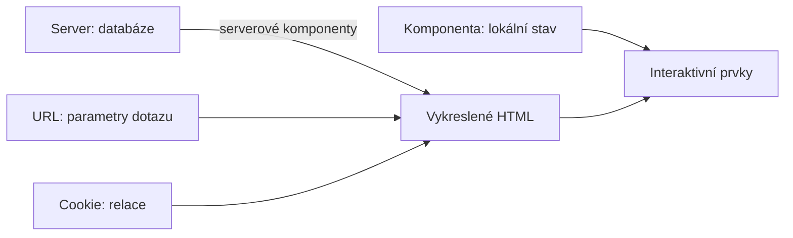

# 02 — Detailní funkční specifikace

> **Protokol nulového úniku kódu.** Žádný řádek zdrojového kódu aplikace. Veškeré
> chování je popsáno číslovanými procedurálními kroky, byznys pravidly a textovými
> schématy.

## Jak číst tento dokument

Systém má **386 zdrojových souborů**. Dokument pokrývá **všechny**; hloubka popisu je
odstupňovaná podle toho, kolik entita nese logiky:

| Hloubka | Co obsahuje | Pro které entity |
|---|---|---|
| **Plná karta** | Účel · vstupní kontrakt · vnitřní stav · procedurální algoritmus · výstup a vedlejší účinky · chybové stavy | Entity nesoucí byznys pravidla — handlery, služby, výpočetní pomocníci, stavové komponenty |
| **Kompaktní karta** | Účel · kontrakt · chování v jedné až třech větách · chybové stavy | Obaly, zobrazovací komponenty, jednoduché převaděče |

Kompaktní karta není vynechání — entita je popsaná úplně, jen je úplný popis krátký,
protože entita dělá jedinou věc.

**Zkratka napříč dokumentem:** „obálka odpovědi" znamená návratový typ domény se stavem
(`úspěch`, `nenalezeno`, `selhání validace`, `zakázáno`, `služba nedostupná`, `chyba`),
volitelnými daty a volitelnou českou hláškou.

---

# A. Autentizace a autorizace

## A.1 Model roli

Tři role, žádná hierarchie — jsou to tři **různé pohledy na stejná data**:

| Role | Klíč v tokenu | Co vidí | Co smí |
|---|---|---|---|
| Krajský úřad | `Kraj` | Celé portfolio včetně částek v Kč | Importovat data, číst vše, spravovat demo zařízení |
| Správce budovy | `Spravce` | Jen objekty své organizace, včetně Kč | Přidat vlastní budovu, upravit ji, spravovat senzory své organizace |
| Veřejnost | `Verejnost` | Vnitřní prostředí objektů, **bez Kč** | Jen čtení |

**Nepřihlášený návštěvník se chová jako veřejnost.** Není to chyba ani zvláštní větev —
veřejná část aplikace nemá přihlášení vůbec.

### Pravidlo viditelnosti částek

Jediné místo, kde se rozhoduje: kontext návštěvníka vystaví příznak „smí vidět peníze",
který je pravdivý pro roli kraje a správce. Všechny výstupy, které obsahují koruny,
se na něj ptají. Veřejnosti se částka **neodešle vůbec** (hodnota je prázdná), nikoli
skryje v rozhraní.

## A.2 `ViewerContext` — kontext návštěvníka

**Umístění:** `backend/SmartAudit.Api/Extentions/ClaimPrincipalExtension.cs`

- **Účel:** Jediná reprezentace „kdo se ptá" napříč celou aplikací.
- **Vstupní kontrakt:** identita požadavku (nároky z tokenu).
- **Vnitřní stav:** role (text) a volitelný identifikátor organizace.
- **Algoritmus:**
  1. Přečte nárok role. Pokud chybí, dosadí roli veřejnosti.
  2. Přečte nárok organizace; pokud chybí nebo není platný identifikátor, ponechá prázdný.
  3. Vystaví odvozený příznak „smí vidět peníze" = role je kraj nebo správce.
- **Výstup:** neměnný záznam role + organizace + příznak.
- **Chybové stavy:** žádné — chybějící nebo poškozený nárok vede na veřejnost, nikdy na výjimku.

## A.3 Rozšíření nad identitou

**Umístění:** tamtéž.

| Operace | Chování | Chybový stav |
|---|---|---|
| Získat identifikátor uživatele | Přečte standardní nárok předmětu a pokusí se ho přeložit na identifikátor | Vrátí nepravdu; volající má připravenou větev (omezení počtu volání pak padne na IP adresu) |
| Získat roli | Přečte vlastní nárok role | Prázdná hodnota |
| Získat organizaci | Přečte vlastní nárok organizace | Prázdná hodnota |

## A.4 Vydání tokenu

**Umístění:** `backend/SmartAudit.Api/Services/TokenService.cs`

- **Účel:** Vydat podepsaný token po úspěšném přihlášení.
- **Vstupní kontrakt:** identifikátor uživatele (povinný), role (povinná), identifikátor organizace (nepovinný).
- **Algoritmus:**
  1. Sestaví nároky: předmět = identifikátor uživatele, vlastní nárok role, jednoznačný identifikátor tokenu.
  2. Pokud je zadaná organizace, přidá vlastní nárok organizace.
  3. Vytvoří symetrický klíč z tajemství nastavení a podpisové údaje algoritmem HMAC-SHA256.
  4. Sestaví token s vydavatelem, publikem, nároky a platností = aktuální čas UTC + nastavený počet minut (výchozí 480, tedy 8 hodin).
  5. Vrátí token jako řetězec.
- **Vedlejší účinky:** žádné — token se nikam neukládá (stateless).
- **Chybové stavy:** krátké tajemství způsobí výjimku už při startu (viz A.8).

## A.5 Přihlášení heslem

**Umístění:** `backend/SmartAudit.Api/Features/Auth/Login/LoginHandler.cs`

- **Účel:** Ověřit e-mail a heslo a vydat token.
- **Vstupní kontrakt:** e-mail (povinný, text), heslo (povinné, text).
- **Algoritmus:**
  1. Pokud je e-mail nebo heslo prázdné, vrátí **selhání validace** s hláškou „Neplatné přihlašovací údaje".
  2. E-mail normalizuje: ořízne okraje a převede na malá písmena.
  3. Najde uživatele podle e-mailu (čtení bez sledování změn).
  4. Vrátí **nenalezeno** se stejnou hláškou, pokud platí kterákoli z podmínek:
     uživatel neexistuje **nebo** je to demo účet **nebo** heslo neodpovídá uloženému otisku.
  5. Vydá token (A.4) a vrátí jej s identifikátorem, zobrazovaným jménem, rolí a organizací.
- **Byznys pravidlo:** **demo účet se nedá přihlásit heslem.** Jde k němu jen tlačítkem demo.
- **Chybové stavy:** neexistující uživatel, demo účet a špatné heslo vracejí **stejnou hlášku**
  a stejný stav — útočník nepozná, který e-mail v systému existuje.

## A.6 Demo přihlášení

**Umístění:** `backend/SmartAudit.Api/Features/Auth/DemoLogin/DemoLoginHandler.cs`

- **Účel:** Pustit porotu nebo nového návštěvníka do aplikace bez zakládání účtu.
- **Vstupní kontrakt:** role (povinná, text) — musí být z povolené množiny.
- **Algoritmus:**
  1. Pokud role není ze seznamu povolených, vrátí **selhání validace** s výčtem povolených rolí.
  2. Najde uživatele, který je označený jako demo **a** má požadovanou roli; načte i název organizace.
  3. Pokud takový uživatel není, vrátí **nenalezeno** s hláškou „Demo účet se ještě připravuje, zkuste to za chvíli."
     — to nastává, dokud nedoběhne první import dat, který demo účty zakládá.
  4. Vydá token a vrátí jej včetně názvu organizace.
- **Chybové stavy:** viz kroky 1 a 3; hláška v kroku 3 je záměrně vysvětlující, ne technická.

## A.7 Správa relace na frontendu

**Umístění:** `frontend/app/login/actions.ts`, `frontend/lib/api.ts`

- **Účel:** Držet token tak, aby se **nikdy nedostal do klientského JavaScriptu**.
- **Algoritmus založení relace:**
  1. Po úspěšné odpovědi API se sestaví objekt relace: token, zobrazované jméno, role, název organizace.
  2. Uloží se do cookie `sa_session` s příznaky: **httpOnly**, `sameSite=lax`,
     `secure` jen v produkci a při výslovném zapnutí, cesta `/`, platnost **8 hodin**.
  3. Následuje přesměrování — po běžném přihlášení na mapu, po demo přihlášení na mapu
     **se zapnutým průvodcem** (nový člověk dostane provedení aplikací).
- **Byznys pravidlo:** veřejnost se nepřihlašuje. Formulář nabízí jen role kraje a správce;
  veřejnost má vlastní část aplikace bez účtu.
- **Odhlášení:** smaže cookie a přesměruje na přihlášení.
- **Chybové stavy:**
  - Chybějící nebo neúplné údaje → „Vyplňte e-mail i heslo."
  - Neznámá role u demo přihlášení → „Neznámá role."
  - Chyba API → předá se česká hláška z odpovědi.
  - Poškozený obsah cookie → relace se vyhodnotí jako neexistující (bez výjimky).

## A.8 Pojistka proti ukázkovým tajemstvím

**Umístění:** `backend/SmartAudit.Api/Services/Security/SecretsGuard.cs`

- **Účel:** Zabránit spuštění v ostrém provozu s klíči, které jsou veřejně v repozitáři.
- **Algoritmus:**
  1. Pokud prostředí je vývojové, neudělá nic.
  2. Jinak zkontroluje JWT tajemství, hesla MQTT a připojovací řetězec databáze proti
     známým ukázkovým hodnotám a proti minimální délce.
  3. Při shodě nebo nedostatečné délce vyhodí výjimku a **aplikace nenastartuje**.
- **Byznys pravidlo:** raději nespustit než běžet s veřejně známým klíčem.

## A.9 Matice oprávnění koncových bodů

| Koncový bod | Metoda | Kraj | Správce | Veřejnost | Nepřihlášený |
|---|---|---|---|---|---|
| `/api/auth/login`, `/api/auth/demo` | POST | ✔ | ✔ | ✔ | ✔ |
| `/api/facilities` (seznam) | GET | ✔ | ✔ | ✔ | ✔ |
| `/api/facilities/{id}` (detail) | GET | ✔ | ✔ | ✔ | ✔ |
| `/api/facilities/{id}/telemetry`, `/heatmap`, `/footprint`, `/section` | GET | ✔ | ✔ | ✔ | ✔ |
| `/api/facilities/address-suggestions`, `/locate` | GET | — | ✔ | — | — |
| `/api/facilities` (vytvoření), `/{id}` (smazání) | POST, DELETE | — | ✔ | — | — |
| `/api/facilities/{id}/contracts`, `/attachments/{id}` | GET | ✔ | ✔ | — | — |
| `/api/facilities/{id}/building`, `/building-parts` (zápis) | PUT, POST, DELETE | ✔ | ✔ | — | — |
| `/api/facilities/{id}/ai-audit` | GET, POST | ✔ | ✔ | — | — |
| `/api/data-sources` | GET | ✔ | ✔ | ✔ | ✔ |
| `/api/data-sources/{key}/import` | POST | ✔ | — | — | — |
| `/api/demo/**` | vše | ✔ | ✔ | — | — |
| `/api/sensors/**` | vše | ✔ | ✔ | — | — |
| `/api/map/regions` | GET | ✔ | ✔ | ✔ | ✔ |
| `/api/reports/**` | GET | ✔ | ✔ | — | — |
| `/api/guide/ask` | POST | ✔ | ✔ | ✔ | ✔ |
| `/api/open/v1/**` | GET | ✔ | ✔ | ✔ | ✔ |
| `/api/status` | GET | ✔ | ✔ | ✔ | ✔ |

> Veřejné koncové body vracejí **tentýž objekt bez finančních polí**, nikoli jiný objekt.

---

# B. Globální stav a správa dat

## B.1 Strategie stavu — záměrná absence knihovny

Aplikace **nemá knihovnu pro správu stavu** (žádný globální sklad). To je rozhodnutí,
ne opomenutí. Stav je rozdělený do čtyř míst:

| Druh stavu | Kde žije | Proč tam |
|---|---|---|
| **Data domény** | Databáze; do rozhraní jdou serverovými komponentami | Nemusí se replikovat do klienta ani synchronizovat |
| **Stav pohledu** (vybraný okres, filtr, vybraný objekt) | **Parametry URL** | Odkaz na konkrétní pohled se dá poslat a obnovit; zpět a vpřed v prohlížeči fungují samy |
| **Relace** | httpOnly cookie | Token nesmí do klientského JavaScriptu |
| **Pomíjivý stav rozhraní** (otevřená karta, rozepsaný dotaz) | Lokální stav komponenty | Nemá smysl ho sdílet |

**Důsledek pro reimplementaci:** nezavádět globální sklad. Pokud se zdá, že je potřeba,
patří ten stav do URL.

## B.2 Čtení stavu pohledu z URL

**Umístění:** `frontend/lib/search-params.ts`

- **Účel:** Jediné místo, které překládá parametry adresy na typovaný stav pohledu.
- **Vstupní kontrakt:** objekt parametrů dotazu (hodnoty mohou být text, pole textů nebo nic).
- **Algoritmus:**
  1. Pro každý známý parametr vezme první hodnotu, pokud přišlo pole.
  2. Ořízne okraje; prázdný text považuje za nezadaný.
  3. Hodnoty z uzavřené množiny (stav auditu, kategorie, veličina) ověří proti povoleným
     hodnotám; neznámou hodnotu zahodí jako nezadanou.
  4. Příznaky čte jako pravdivé při hodnotě `1` nebo `true`.
- **Výstup:** typovaný objekt filtru.
- **Chybové stavy:** neznámá hodnota nikdy nevede na chybu — chová se jako nezadaná,
  takže upravená adresa v řádku prohlížeče aplikaci nerozbije.

## B.3 Perzistence a migrace schématu

| Mechanismus | Chování |
|---|---|
| Kontext databáze | Vystavuje 21 množin entit; zapíná rozšíření PostGIS; konfigurace entit se načítají **hromadně z assembly** |
| Migrace | Historie od výchozí migrace přes přidání AI analýz, fyzických senzorů, otisku vstupu AI, oddílů tabulky měření, smluv, demo zařízení a úprav budov |
| Oddíly tabulky měření | Tabulka měření je rozdělená **po měsících**; oddíly zakládá dopředu služba na pozadí |
| Identifikátory | Všechny entity používají **časově uspořádaný identifikátor** (verze 7), takže nové záznamy neštěpí index |

## B.4 Zapouzdření entit

**Byznys pravidlo platné pro všech 21 entit:** vlastnosti mají **privátní nastavení**
a mění se výhradně pojmenovanými metodami. Konstruktor i metody validují vstup a při
porušení vyhodí výjimku s českou hláškou.

| Entita | Nezměnitelná pravidla | Metody změny |
|---|---|---|
| **Objekt** (`Facility`) | Zdrojový klíč nesmí být prázdný · název nesmí být prázdný · **poloha musí být v souřadnicovém systému WGS84** | přejmenovat · přemístit · přiřadit kód · nastavit identifikátory · nastavit adresu · přiřadit organizaci · nastavit památkovou ochranu · nastavit simulační profil |
| **Posudek** (`FacilityAssessment`) | — | aktualizovat (stav, titulek, shrnutí, zjištění, poslední hodnoty, hodiny nad limitem, průměry, týdenní energie, roční ztráta, procento úspory) · zapomenout základnu měření |
| **Budova** (`FacilityBuilding`) | — | odvozené hodnoty **upřednostňují opravu od správce** před údajem z katastru |
| **Část budovy** (`FacilityBuildingPart`) | Plocha musí být kladná | — |
| **Zdroj dat** (`DataSource`) | Klíč nesmí být prázdný · název nesmí být prázdný | aktualizovat · označit jako importovaný |
| **Import** (`DataImport`) | Počet záznamů nesmí být záporný | dokončit (stav, počet, chyba) |
| **AI analýza** (`AiAnalysis`) | Model nesmí být prázdný · shrnutí nesmí být prázdné | neměnná po vytvoření |
| **Demo zařízení** (`DemoDevice`) | Sériové číslo = **přesně 8 hexadecimálních znaků** · gateway má **1 až 3** uzly · adresa uzlu **1–239** · čidlo musí mít rodičovskou gateway | neměnné po vytvoření; zakládá se dvěma továrními metodami (gateway, uzel) |

### Byznys pravidlo: objekty přidané správcem

Objekt vytvořený správcem má zdrojový klíč s **předponou `spravce:`**. Import otevřených
dat podle této předpony pozná, že objekt nepochází z otevřených dat, a **nesmí ho smazat**
při synchronizaci.

## B.5 Datová roura

**Umístění:** `backend/SmartAudit.Api/Services/Import/DataPipelineService.cs`,
`OpenDataImportService.cs`, `PortfolioService.cs`, `BuildingEnrichmentService.cs`,
`SnapshotStore.cs`, `PipelineStateService.cs`

- **Účel:** Naplnit databázi otevřenými daty tak, aby aplikace fungovala i **bez připojení k síti**.
- **Algoritmus (po startu aplikace):**
  1. Služba na pozadí nastaví stav roury na „běží".
  2. Pro každý nakonfigurovaný zdroj dat (30 položek):
     1. Zkusí stáhnout data z vzdálené služby.
     2. Při úspěchu **přepíše místní snímek** aktuálními daty (pokud je zápis snímků zapnutý)
        a označí import jako **živý**.
     3. Při selhání načte **místní snímek** ze složky a označí import jako **ze snímku**.
     4. Při selhání obojího zapíše import jako **neúspěšný** s textem chyby.
     5. Zapíše počet záznamů a čas importu do zdroje dat.
  3. Sestaví portfolio objektů: sloučí seznamy škol, sociálních služeb, nemocnic,
     následné péče a léčebných ústavů; filtruje na objekty zřizované krajem.
  4. Obohatí budovy o údaje z katastru (půdorys, zastavěná plocha, rok výstavby,
     kód RÚIAN, parcela) s nastavenou mírou souběžnosti.
  5. Přiřadí památkovou ochranu průnikem polohy objektu s plochami zón, rezervací
     a národních kulturních památek.
  6. Založí demo účty pro všechny tři role.
  7. Nastaví stav roury na „hotovo".
- **Vedlejší účinky:** zápis do databáze, přepis snímků na disku, vznik demo uživatelů.
- **Chybové stavy:**
  - Nedostupná vzdálená služba → tichý ústup na snímek, aplikace běží dál.
  - Chybějící snímek i síť → zdroj je označený jako neúspěšný; aplikace běží bez něj.
  - Objekt se zdrojovým klíčem správce se **nikdy nemaže**.

## B.6 Stav roury

**Umístění:** `backend/SmartAudit.Api/Services/PipelineStateService.cs`

- **Účel:** Nechat rozhraní poznat, že se data ještě připravují.
- **Vnitřní stav:** příznak „běží" a čas posledního dokončení; drží se v paměti
  (jediná instance na proces).
- **Výstup:** čte ho koncový bod stavu a rozhraní podle něj zobrazí, že se portfolio plní.

---

# C. Uživatelské rozhraní a komponenty

## C.1 Mapa tras

| Trasa | Skupina | Přístup | Role stránky |
|---|---|---|---|
| `/` | `(public)` | kdokoli | Rozcestník veřejné části |
| `/objekty` | `(public)` | kdokoli | Seznam objektů s filtry |
| `/objekty/[kod]` | `(public)` | kdokoli | Veřejná karta objektu — vnitřní prostředí, **bez Kč** |
| `/objekty/[kod]/qr` | `(public)` | kdokoli | Tisknutelný QR kód na kartu objektu |
| `/login` | — | kdokoli | Přihlášení a demo účty |
| `/mapa` | `(app)` | přihlášený | **Hlavní obrazovka** — mapa kraje s inspekčním panelem |
| `/portfolio` | `(app)` | přihlášený | Seznam objektů s řazením |
| `/anomalie` | `(app)` | přihlášený | Objekty se zjištěním |
| `/senzory` | `(app)` | přihlášený | Seznam gatewayí a průvodce zapojením |
| `/senzory/[id]` | `(app)` | přihlášený | Detail gatewaye, uzly v dosahu |
| `/smlouvy/...` | `(app)` | kraj, správce | Stažení přílohy smlouvy |
| `/budovy/nova` | `(app)` | správce | Přidání vlastní budovy |
| `/demo` | `(app)` | kraj, správce | Demo správa zařízení |
| `/reporty` | `(app)` | kraj, správce | Výběr a stažení PDF reportů |
| `/otevrena-data` | `(app)` | přihlášený | Ukázka veřejného API |
| `/zdroje-dat` | `(app)` | přihlášený | **Panel zdrojů dat — povinný odkaz na otevřená data** |

## C.2 Rozvržení

### C.2.1 Kořenové rozvržení
**Umístění:** `frontend/app/layout.tsx`

- **Účel:** Nastavit jazyk, písma, metadata a globální chování posuvníku.
- **Algoritmus:**
  1. Zavede tři písma a vystaví je jako proměnné CSS.
  2. Nastaví jazyk dokumentu na češtinu a výšku na celý výřez.
  3. Vloží komponentu termo posuvníku (C.9.1).
  4. Vykreslí potomky do svislého pružného kontejneru o výšce dynamického výřezu.
- **Metadata:** název „SmartAudit · Královéhradecký kraj", popis, název aplikace,
  barva motivu `#0B192C`. Ikony a manifest se zavádějí podle konvence názvů souborů.

### C.2.2 Rozvržení přihlášené části
**Umístění:** `frontend/app/(app)/layout.tsx`

- **Algoritmus:**
  1. Načte relaci z cookie.
  2. Pokud relace není, **přesměruje na přihlášení**.
  3. Vykreslí postranní navigaci (na širokém displeji) nebo spodní navigaci (na úzkém),
     horní lištu s identitou a odhlášením a hlavní oblast.
- **Chybové stavy:** soubor `error.tsx` zachytí chybu kterékoli podřízené stránky a nabídne
  opakování; `loading.tsx` ukáže kostru během načítání.

### C.2.3 Rozvržení veřejné části
**Umístění:** `frontend/app/(public)/layout.tsx`

- Bez kontroly přihlášení. Vlastní jednoduchá nabídka a hledání školy.

## C.3 Hlavní obrazovka — mapa

**Umístění:** `frontend/app/(app)/mapa/page.tsx` + `_components/*`

Nejsložitější obrazovka aplikace. Skládá se z mapy, panelu nad ní a inspekčního panelu.

### C.3.1 Stránka mapy (serverová komponenta)
- **Vstupní kontrakt:** parametry dotazu — hledaný text, okres, ORP, kategorie, stav,
  jen se zjištěním, vybraný objekt, zapnutý průvodce.
- **Algoritmus:**
  1. Přečte relaci a parametry pohledu (B.2).
  2. Načte seznam objektů podle filtru a zároveň souhrn po okresech **z celého kraje**
     (nefiltrovaný), aby barvy okresů zůstaly stálé.
  3. Pokud je v parametrech vybraný objekt, načte jeho detail.
  4. Předá data klientským komponentám mapy a panelu.
- **Byznys pravidlo:** statistiky okresů se počítají vždy z celého kraje, nikdy z filtru.

### C.3.2 `facility-map` — plátno mapy
- **Účel:** Vykreslit kraj, okresy a objekty ve třech úrovních přiblížení.
- **Vnitřní stav:** instance mapy, aktuální úroveň (kraj / okres / objekt), připravenost stylu.
- **Algoritmus:**
  1. Vytvoří mapu bez dlaždicového podkladu — podkladem jsou **polygony hranic**.
  2. Po připravení stylu přidá vrstvy: obrys kraje, výplně okresů (choroplet),
     špendlíky objektů, volitelně půdorys a 3D extruzi vybrané budovy.
  3. Na úrovni kraje zobrazí **bubliny okresů** se souhrnem; po kliknutí přiblíží na okres.
  4. Na úrovni okresu zobrazí **špendlíky objektů** s postupným „dopadem" (zpoždění po jednotlivých prvcích).
  5. Kliknutí na objekt zapíše jeho identifikátor do adresy — panel se otevře díky změně URL.
  6. Sleduje změnu velikosti kontejneru a přepočítá rozměry mapy.
- **Chybové stavy:** chybějící geometrie objektu → špendlík se nevykreslí;
  nepřipravený styl → vrstvy se přidají až po události připravenosti (jinak by se ztratily).

### C.3.3 Komponenty mapy — kompaktní karty

| Komponenta | Účel | Kontrakt | Chování |
|---|---|---|---|
| `district-layer` | Výplně okresů | souhrn po okresech | Obarví polygon podle podílu objektů se zjištěním (pětitřídní škála z dokumentu 03) |
| `district-select` | Výběr okresu | seznam okresů, aktuální | Zapíše volbu do adresy |
| `facility-dots` | Body objektů | seznam objektů | Vykreslí body obarvené podle stavu auditu |
| `facility-pin` | Špendlík | objekt, pořadí | Animace „dopadu" se zpožděním podle pořadí |
| `facility-search` | Hledání objektu | — | Zapisuje hledaný text do adresy |
| `map-click-router` | Směrování kliknutí | — | Překládá kliknutí v mapě na změnu adresy |
| `map-filter-bar` | Filtry | aktuální filtr | Kategorie, stav, jen se zjištěním |
| `map-legend` | Legenda | — | Vysvětluje škálu choropletu a barvy stavů |
| `map-toolbar` | Nástroje mapy | — | Přepínače vrstev |
| `issues-toggle` | Přepínač zjištění | aktuální stav | Zapne nebo vypne filtr „jen se zjištěním" |
| `kpi-row` | Souhrnná čísla | souhrn | Počet objektů, se zjištěním, celková ztráta (**jen při oprávnění vidět Kč**) |
| `selected-building-3d` | 3D extruze budovy | půdorys, podlaží | Vykreslení plastického 3D modelu objektu nad mapou (viz detail C.3.4) |
| `own-buildings` | Vlastní budovy | objekty správce | Zvýrazní objekty organizace |
| `new-building-notice` | Upozornění | — | Nabídne správci přidání budovy |
| `executive-summary-link`, `portfolio-report-link` | Odkazy na reporty | — | Odkaz na trasu, která vrací PDF |
| `copy-button` | Kopírování | text | Zkopíruje do schránky a potvrdí |
| `mobile-nav`, `sidebar`, `sidebar-nav`, `top-bar` | Navigace | relace | Postranní na širokém, spodní na úzkém displeji |

### C.3.4 Technické řešení 3D extruze budovy v MapLibre GL (`selected-building-3d`)

- **Účel:** Vykreslit prostorový trojrozměrný polygon budovy přímo v plátně mapy při přiblížení na úroveň objektu (zoom > 14).
- **Vstupní kontrakt:** GeoJSON geometrie půdorysu z `/api/facilities/{id}/footprint`, počet podlaží (celé číslo), stav auditu, indikátor ručního ověření.
- **Proces vykreslení:**
  1. Frontend načte vektorový 2D polygon budovy z endpointu `/api/facilities/{id}/footprint`. Geometrie pochází primárně z tématu ČÚZK INSPIRE Budovy (vrstva budov s parcelním číslem a kódem RÚIAN).
  2. Do instance MapLibre GL se zaregistruje GeoJSON zdroj a přidá se vrstva typu `fill-extrusion` s identifikátorem `selected-building-3d`.
  3. Konfigurace vlastností vrstvy:
     - `fill-extrusion-color`: dynamicky mapovaná barva podle stavu auditu budovy (zelená `#10B981` při optimálním chodu, jantarová `#F59E0B` při varování, červená `#EF4444` při kritické anomálii, popř. výchozí tmavě modrá `#1E3E62` při neutrálním zobrazení),
     - `fill-extrusion-height`: efektivní výška budovy vypočtená dle vzorce níže,
     - `fill-extrusion-base`: 0 m (úroveň terénu),
     - `fill-extrusion-opacity`: 0.88 (mírná průhlednost pro zachování čitelnosti okolního terénu a parcelních hranic),
     - `fill-extrusion-vertical-gradient`: `true` (svislý světelný přechod generující realistické stínování fasád a hran).
- **Výpočetní vzorec výšky budovy:**
  $$\text{výška (m)} = \text{počet podlaží} \times 3{,}2\,\text{m}$$
  Hodnota $3{,}2\,\text{m}$ představuje normalizovanou konstrukční výšku podlaží typickou pro veřejné, školské a nemocniční budovy v ČR.
- **Závazné pravidlo poctivosti k datům (Data Honesty):**
  Katastr nemovitostí (ČÚZK INSPIRE) ani RÚIAN ve svých otevřených službách neposkytují počet nadzemních podlaží budovy. Aplikace proto používá výchozí heuristiku:
  $$\text{výchozí počet podlaží} = \max\left(1, \operatorname{round}\left(\frac{\text{podlahová užitná plocha}}{\text{zastavěná plocha}}\right)\right)$$
  Pokud užitná plocha není známa, aplikuje se typologický standard kategorie (např. MŠ = 2, ZŠ/SŠ = 3, nemocnice = 4).
  **Tato hodnota je v uživatelském rozhraní VŽDY povinně označena viditelným štítkem „Odhadováno“** (oranžovo-šedý badge), aby uživatel nebyl klamán domnělou geodetickou přesností.
- **Možnost přepsání správcem (Admin Override):**
  Správce budovy má v editačním formuláři `building-data-form` (v záložce Budova) možnost zadat skutečný počet podlaží, upravit vytápěnou plochu i rok výstavby.
  Po odeslání na endpoint `POST /api/facilities/{id}/building-override`:
  1. Hodnoty se trvale uloží do databáze jako autoritativní oprava správce.
  2. Štítek v rozhraní se okamžitě změní z „Odhadováno“ na **„Ověřeno správcem“** (zelený badge).
  3. Vrstva `selected-building-3d` v mapě se okamžitě překreslí s novou přesnou výškou.
  4. Přepočítá se celková tepelná ztráta objektu a normalizovaná energetická bilance.

---

## C.4 Inspekční panel

**Umístění:** `frontend/app/(app)/_components/inspection/*`

Plovoucí boční inspekční panel s pěti záložkami, který se vysune po výběru objektu v mapě nebo v portfoliu (pevná šířka 440 px na desktopu, vysouvací plnohodnotný překryv na mobilních zařízeních).

### C.4.1 `inspection-panel` — hostitel
- **Vnitřní stav:** aktivní záložka (výchozí „Přehled“), rozbalení/sbalení panelu.
- **Algoritmus:** vykreslí hlavičku s názvem objektu, typem zřizovatele, adresou, stavovou pilulkou auditu (Optimální / Varování / Kritická) a záložkovou lištou o 5 položkách; podle aktivní záložky vykreslí jednu z pěti níže uvedených sekcí.

### C.4.2 Záložka „Přehled“ (`overview-tab`)
- **Obsah a prvky:**
  1. Celkový stav energetického auditu s ikonou a vysvětlujícím titulkem.
  2. Strukturovaný seznam aktivních zjištění a anomálií (např. vytápění mimo provozní dobu, chybějící noční útlum, překročení limitu CO₂).
  3. Karta okamžitých hodnot: poslední odečtená teplota, relativní vlhkost a CO₂ s časem posledního měření.
  4. Ekonomické metriky: odhadovaná roční finanční ztráta v Kč a potenciál úspory v % (**zobrazuje se VÝHRADNĚ uživatelům s rolí Kraj nebo Správce**; pro roli Veřejnost je celá sekce s částkami potlačena).
  5. Územní a legislativní kontext: příznak památkové ochrany (zda leží v památkové rezervaci či zóně dle Data KHK), indikátor hospodářsky ohroženého území (ORP) a vazba na dotační tituly.

### C.4.3 Záložka „Budova“ (`building-tab`)
- **Obsah a prvky:**
  1. Katastrální a technické parametry: zastavěná plocha (m²), podlahová vytápěná plocha (m²), počet podlaží (s indikátorem „Odhadováno“ / „Ověřeno správcem“), rok výstavby, odhad energetické třídy náročnosti (A–G), parcelní číslo a kód budovy v RÚIAN.
  2. Přímý odkaz do nahlížení do katastru nemovitostí ČÚZK.
  3. **3D vizualizace a schematický vertikální řez budovy (`facility-section`)**: zobrazení vertikálního uspořádání pater a funkčních zón budovy s vazbou na rozmístěná čidla IQRF (viz detail C.4.8).
  4. `building-data-form`: formulář správce pro korekci počtu podlaží, plochy a roku výstavby s tlačítkem „Uložit ověřené údaje“.
  5. `building-parts-list`: správa přilehlých pavilonů a vedlejších objektů zapsaných správcem; jejich podlahová plocha se automaticky přičítá k vytápěné ploše objektu.
  6. `remove-building-button`: tlačítko pro vyřazení budovy z portfolia s bezpečnostním potvrzovacím dialogem.

### C.4.4 Záložka „Telemetrie“ (`telemetry-tab`)
- **Obsah a prvky:**
  1. `temperature-chart`: interaktivní časový graf zvolené veličiny (teplota ve °C, CO₂ v ppm, vlhkost v %) s přepínačem časového rozsahu (24 hodin, 7 dní, 30 dní) a zobrazením mezí komfortu a útlumu.
  2. `heatmap-grid`: matice 7 dní v týdnu × 24 hodin obarvená sekvenčním termo gradientem; okamžitě vizuálně odhaluje nežádoucí vytápění během víkendů a nocí.
  3. `rooms-now`: přehled živých odečtů po jednotlivých sledovaných místnostech a zónách.
  4. `energy-bars`: sloupcový graf týdenní agregované spotřeby tepla normalizované na denostupně z Open-Meteo.
  5. **Chybový stav:** pokud objekt nemá osazena čidla ani simulaci, zobrazí se zástupná karta se zprávou „Telemetrická data se připravují“.

### C.4.5 Záložka „Audit“ (`audit-tab`, `ai-audit-section`, `ai-audit-card`, `ai-actions.ts`)
- **Obsah a prvky:**
  1. Výsledky AI auditu generované velkým jazykovým modelem (Azure OpenAI / OpenAI) nad reálnými daty budovy.
  2. Shrnutí stavu a detailní identifikace primární příčiny tepelných či provozních ztrát.
  3. Seznam doporučených úsporných opatření vybraných z katalogu: každá položka obsahuje odhadované investiční náklady v Kč, předpokládanou roční úsporu v Kč, prostou dobu návratnosti v letech a posouzení proveditelnosti z hlediska památkové péče.
  4. Generátor úředního dopisu zřizovateli: strukturovaný koncept dopisu řediteli organizace nebo radnímu kraje s věcnou argumentací a kalkulací návratnosti.
  5. Tlačítko pro spuštění nového přehodnocení auditu se stavem načítání a indikátorem mezipaměti podle otisku vstupu.
- **Chybové stavy:**
  - Model není nastavený → **služba nedostupná** s vysvětlující hláškou, zbytek panelu funguje.
  - Překročený limit volání → hláška s dobou, za jakou to jde zkusit znovu.
  - Stejný vstup jako minule → vrátí se **uložený výsledek**, model se nevolá (viz D.6).

### C.4.6 Záložka „Smlouvy“ (`contracts-tab`)
- **Obsah a prvky:**
  1. Přehled energetických a servisních smluv dohledaných v Registru smluv DIA pro danou příspěvkovou organizaci.
  2. Automatická kategorizace: dodávka tepla, dodávka zemního plynu, dodávka elektřiny, servis MaR a kotelen, stavební úpravy a zateplení.
  3. Vyextrahované jednotkové ceny energií (Kč/GJ u tepla, Kč/MWh u plynu/elektřiny) získané pomocí knihovny PdfPig z textových vrstev PDF smluv.
  4. Metadata smlouvy: název dodavatele, IČO, datum uzavření smlouvy, hodnota plnění a přímý odkaz na detail smlouvy v registru `smlouvy.gov.cz` včetně možnosti stažení originálního PDF.

### C.4.7 `panel-card`
- Kompaktní obalový kontejner se standardním zaoblením `--radius-xl` (14 px), ohraničením `--border` a volitelným záhlavím s nadpisem stupně H5; sjednocuje vizuální rytmus všech pěti záložek.

### C.4.8 Schematický vertikální řez budovy (`/api/facilities/{id}/section`)

- **Účel:** Poskytnout intuitivní rentgenový pohled na vnitřní uspořádání budovy, její patra, funkční zóny a prostorové rozmístění IQRF čidel.
- **Endpoint kontraktu:** `GET /api/facilities/{id}/section`
- **Datový model řezu:**
  Hierarchická struktura pater řazených vertikálně od podzemních podlaží (1. PP) přes nadzemní podlaží (1. NP až n. NP) po podkroví/střechu. Každé patro obsahuje pole zón/místností s jejich funkčním typem (např. `Trida`, `Kabinet`, `Telocvicna`, `Jidelna`, `Kotelna`, `Chodba`), plochou a přiřazenými senzory.
- **Vizuální a procedurální reprezentace:**
  1. **Patrové bloky:** Budova je zobrazena jako schematický řez složený z vodorovných pruhů reprezentujících jednotlivá patra. V záhlaví každého patra je uveden jeho název, orientační plocha a počet instalovaných senzorů.
  2. **Funkční zóny:** Uvnitř patrového pruhu jsou vedle sebe vykresleny jednotlivé místnosti jako samostatné buňky. Zóny jsou typologicky rozlišeny (učebny, zázemí, technické místnosti).
  3. **Rozmístění IQRF čidel s živými odečty:**
     - V každé sledované místnosti je zobrazena ikona bezdrátového čidla IQRF.
     - U čidla se vykreslují aktuální měřené hodnoty: vnitřní teplota (°C) a koncentrace CO₂ (ppm).
     - Rychlé barevné kódování stavu mikroklimatu místnosti:
       * **Zelená (optimální):** teplota v komfortním rozmezí 20–22 °C (v provozu) resp. 16–18 °C (útlum), CO₂ < 1000 ppm.
       * **Jantarová (varování):** CO₂ v pásmu 1000–1500 ppm nebo teplota mírně mimo komfortní meze (např. 18–19 °C nebo 23–24 °C).
       * **Červená (kritická anomálie):** CO₂ > 1500 ppm (akutní potřeba vyvětrat dle hygienické normy) nebo závažná anomálie vytápění (přetápění o víkendu > 22 °C, nedotápění v mrazu < 15 °C).
  4. **Interaktivita:** Kliknutí na místnost nebo čidlo v řezu přepne zobrazení v záložce Telemetrie na časovou řadu daného konkrétního senzoru.

## C.5 Ostatní stránky přihlášené části — kompaktní karty

| Stránka | Účel | Algoritmus v kostce | Chybové stavy |
|---|---|---|---|
| `/portfolio` | Seznam objektů | Načte objekty, seřadí podle volby (`portfolio-sort-select`), vykreslí tabulku se stavem a ztrátou | Prázdné portfolio → sdělení, že se data připravují |
| `/anomalie` | Objekty se zjištěním | Načte objekty filtrované na stav varování a kritický | Žádné zjištění → pozitivní sdělení, ne prázdná tabulka |
| `/senzory` | Gatewaye a zapojení | Seznam gatewayí (`gateway-list`, `gateway-row`), živý stav (`gateway-live`), průvodce (`setup-guide`, `sensor-steps`), připojení (`connect-gateway-form`), párování (`pair-device-form`, `pairing-parts`), zařízení v dosahu (`nearby-devices-panel`), testovací síť (`demo-network-panel`), odkaz na prohlídku (`sensor-tour-link`), informace pro veřejnost (`public-monitoring-info`) | Broker nedostupný → stav „nepřipojeno" u gatewaye, aplikace běží |
| `/senzory/[id]` | Detail gatewaye | Uzly v dosahu (`nearby-nodes`), přiřazení kanálu k zóně | Gateway neexistuje → nenalezeno |
| `/budovy/nova` | Přidání budovy | Našeptávač adres (`address-search`), dohledání místa (`place-card`, `place-map`), údaje (`building-fields`, `building-options`), odeslání (`add-building-form`) | Adresa nedohledaná → česká hláška z API |
| `/demo` | Demo správa | Vytvoření gatewaye a uzlu (`create-gateway-form`, `create-node-form`), seznam (`demo-device-list`), opravy ztráty (`loss-corrections`), pracovní plocha (`demo-workspace`) | Neplatné sériové číslo → hláška z validace entity |
| `/reporty` | PDF reporty | Výběr objektu (`facility-report-picker`), odkazy na tři druhy reportů | Chyba generování → chybová stránka |
| `/otevrena-data` | Ukázka API | Sestaví absolutní adresy ukázek z původu požadavku | — |
| `/zdroje-dat` | Zdroje dat | Vypíše zdroje včetně stavu posledního importu, počtu záznamů a odkazu na portál | Zdroj neúspěšný → zobrazí se text chyby, ne skrytí |

## C.6 Veřejná část a generování tisknutelných QR kódů

Veřejná zóna aplikace je určena pro žáky, studenty, pedagogy, rodiče a širokou veřejnost. Je zcela přístupná bez nutnosti přihlášení a klade důraz na srozumitelnou prezentaci kvality vnitřního prostředí.

### C.6.1 Přehled tras veřejné části

| Trasa / komponenta | Účel | Vstupní kontrakt | Zvláštnosti a omezení |
|---|---|---|---|
| `/` (`(public)/page.tsx`) | Veřejný rozcestník | — | Interaktivní vyhledávání školy (`school-search`, `search-items`), rychlé odkazy na pilotní školy a krajský portál otevřených dat (`public-menu`, `public-links`) |
| `/objekty` | Seznam veřejných budov | Filtr dle obce, typu školy a přítomnosti čidel | Všechny tabulky a filtry (`object-filters`) jsou **zcela oproštěny od finančních ukazatelů** |
| `/objekty/[kod]` | Veřejná karta mikroklimatu | Textový slug kódu budovy (např. `gymnazium-broumov`) | Grafy CO₂ (`co2-chart`), vnitřní teploty a relativní vlhkosti, doporučení k větrání, **striktní zákaz částek v Kč** |
| `/objekty/[kod]/qr` | Tisknutelný QR štítek | Kód budovy | Tisková šablona formátu A5/A4, vektorový QR kód, tlačítko okamžitého tisku (`print-button`) |

### C.6.2 Veřejný detail objektu (`/objekty/[kod]`)

- **Účel:** Poskytnout komunitě školy transparentní vhled do kvality vnitřního vzduchu a tepelného komfortu v učebnách.
- **Identifikace:** Adresování probíhá výhradně přes **stabilní a čitelný kód objektu** (slug v URL, např. `/objekty/sps-hronov`), nikoli přes technický číselný nebo GUID identifikátor.
- **Obsah a vizualizace:**
  1. **Okamžitý stav mikroklimatu:** velký stavový semafor kvality vzduchu (Optimální / Zvýšená koncentrace / Nutno vyvětrat).
  2. **Graf koncentrace oxidu uhličitého CO₂ (`co2-chart`):** interaktivní časový průběh za posledních 24 hodin a 7 dní s vyznačenými referenčními hygienickými hladinami:
     - zelené pásmo `< 1 000 ppm` (svěží vzduch, optimální soustředění),
     - žluté pásmo `1 000 – 1 500 ppm` (zvýšená únava, doporučeno větrání),
     - červené pásmo `> 1 500 ppm` (překročení hygienického limitu dle vyhlášky, nutno okamžitě vyvětrat).
  3. **Graf teploty a vlhkosti:** průběh vnitřní teploty s vyznačeným pásmem optimálního komfortu (20–22 °C během výuky).
  4. **Chytré doporučení pro větrání:** aplikace kombinuje vnitřní data s venkovní kvalitou ovzduší z Open-Meteo API (polétavý prach PM2.5 a PM10). Pokud je venkovní vzduch čistý a uvnitř stoupá CO₂, doporučí intenzivní nárazové větrání okny. Při smogové situaci doporučí větrání zkrátit.
- **Striktní bezpečnostní a byznys pravidlo (Protokol nulového úniku finančních dat):**
  Veřejné API endpointy (`/api/open/facilities/{code}` a související) **NESMÍ ZA ŽÁDNÝCH OKOLNOSTÍ** vracet finanční data v Kč (roční náklady na vytápění, finanční vyčíslení ztrát, částky investic, kalkulace úspor ani jednotkové ceny ze smluv). Finanční pole jsou v DTO schématech zcela vynechána nebo vrácena jako `null`. Veřejný frontend tyto údaje vůbec neobsahuje a nemá k nim přístup.

### C.6.3 Tisknutelný QR štítek pro školy (`/objekty/[kod]/qr`)

- **Účel:** Vygenerovat oficiální informační plakátek s QR kódem, který může správce budovy vytisknout a vyvěsit ve třídách, odborných učebnách, na chodbách a ve vestibulu školy.
- **Algoritmus generování:**
  1. Získá kanonickou veřejnou adresu karty školy pomocí zjištění původu požadavku (`request-origin`).
  2. Knihovna `qrcode` vygeneruje monochromatický vektorový QR kód s vysokým kontrastem a chybovou korekcí úrovně M (odolný proti drobnému poškození či pomačkání papíru).
  3. Stránka vykreslí tiskovou šablonu:
     - Oficiální záhlaví Královéhradeckého kraje s logem a textem „Chytrá škola — monitoring vnitřního prostředí“.
     - Plný název školy a její adresa.
     - Centrální QR kód o rozměrech 140 × 140 mm (při tisku).
     - Instrukční text: *„Naskenujte fotoaparátem svého mobilního telefonu pro zobrazení živého stavu kvality vzduchu, teploty a doporučení k větrání v této budově.“*
     - Informace o zapojení školy do projektu SmartAudit KHK a odkaz na otevřená data kraje.
  4. Komponenta `print-button`: výrazné tlačítko „Vytisknout štítek“, které vyvolá nativní dialog tisku prohlížeče (`window.print()`).
  5. **Tiskový styl (CSS `@media print`):**
     - Automaticky skryje veškeré navigační prvky, tlačítko tisku, patičky webu a systémové lišty.
     - Nastaví formát stránky na pevnou velikost A4 nebo A5 na výšku (`@page { size: portrait; margin: 15mm; }`).
     - Vynutí čisté bílé pozadí a černý text pro úsporný a ostrý tisk na školních tiskárnách.

## C.7 Průvodce aplikací (prohlídka)

**Umístění:** `frontend/app/(app)/_components/tour/app-tour.tsx`, `tour-steps.ts`

- **Účel:** Provést nového člověka aplikací. Spouští se po demo přihlášení.
- **Vnitřní stav:** index aktuálního kroku, viditelnost.
- **Algoritmus:**
  1. Pokud adresa obsahuje příznak průvodce, spustí se od prvního kroku.
  2. Každý krok ukáže bublinu u určeného prvku a čeká na potvrzení.
  3. Krok může vyžadovat změnu adresy (přechod na jinou stránku).
  4. Po posledním kroku se průvodce zavře a příznak z adresy zmizí.
- **Chybový stav:** cílový prvek kroku na stránce není → krok se přeskočí, průvodce nespadne.

## C.8 Komponenty rozhraní (`components/ui`)

Všechny jsou tenké obaly nad nestylovanými primitivy; vzhled je popsaný v dokumentu `03`.

| Komponenta | Kontrakt | Chování |
|---|---|---|
| `button` | druh (6 variant), velikost (8 variant), ostatní vlastnosti primitivu | Složí třídy podle variant; stav otevřené nabídky a chybný stav řídí atributy |
| `input` | typ, ostatní vlastnosti pole | Jednotná výška a stavy |
| `textarea` | — | Svisle měnitelná velikost |
| `select` | položky, vybraná hodnota | Přístupná nabídka |
| `checkbox` | zaškrtnuto, změna | — |
| `combobox` | položky, hledaný text | Našeptávač s filtrem |
| `input-group` | potomci | Spojí pole a tlačítko do jednoho celku |
| `map` | styl, výřez, vrstvy | Obal nad knihovnou mapy; řeší připravenost stylu a úklid |
| `live-badge` | čas posledního kontaktu | Ukáže, zda jsou data živá, a stáří údaje |

## C.9 Zvláštní komponenty

### C.9.1 `thermal-scrollbar`
- **Účel:** Posuvník jako snímek z termokamery — s posunem dolů se „ohřívá".
- **Vnitřní stav:** množina prvků čekajících na překreslení, identifikátor snímku animace.
- **Algoritmus:**
  1. Naslouchá události posunu **v zachytávací fázi na dokumentu** — událost posunu
     neprobublává, takže jinak by se z vnořených prvků nezachytila.
  2. Přidá prvek do množiny čekajících a naplánuje překreslení na další snímek
     (víc událostí v jednom snímku se sloučí do jednoho výpočtu).
  3. Pro každý prvek spočítá poměr posunu (svisle, jinak vodorovně).
  4. Z poměru odvodí barvu interpolací mezi pěti body termo škály a nastaví na prvek
     dvě proměnné CSS: aktuální barvu a barvu posunutou o 0,18 (žhavé jádro).
- **Chybové stavy:** prvek bez možnosti posunu → poměr 0; prohlížeč bez podpory
  pseudoprvků posuvníku dostane aspoň barvu jezdce.

### C.9.2 Značkové komponenty (`components/brand`)
- Symbol se čtyřmi okny, která se při načítání postupně rozsvěcí (animace `brand-window`).

### C.9.3 Panel průvodce (`components/guide`)
- Vysouvací panel nad obsahem, který pokládá dotazy službě průvodce.
- **Vnitřní stav:** historie dotazů, rozepsaný dotaz, stav odesílání.
- **Algoritmus:** odešle dotaz se **kontextem aktuální obrazovky** a zkrácenou historií;
  odpověď vykreslí po krocích (animace `guide-step`) včetně případného grafu.
- **Chybové stavy:** překročený limit → hláška „Průvodce dostal moc dotazů najednou…";
  model nenastavený → **záložní režim** bez modelu (viz D.7).

---

# D. API integrace, síťová komunikace a externí služby

## D.1 Vzor volání — platí pro všech 11 controllerů

Controller **nikdy neobsahuje logiku**. Vždy stejná posloupnost:

1. Přijme požadavek a (pokud je potřeba) přečte kontext návštěvníka.
2. Sestaví příkaz nebo dotaz.
3. Odešle ho sběrnici.
4. Převede obálku odpovědi na HTTP výsledek rozšiřující metodou.

### Překlad stavu obálky na HTTP kód

| Stav obálky | HTTP | Tělo |
|---|---|---|
| úspěch | 200 | data |
| nenalezeno | 404 | zpráva |
| selhání validace | 400 | zpráva |
| zakázáno | 403 | zpráva |
| služba nedostupná | 503 | zpráva |
| chyba | 500 | zpráva |

**Vedlejší účinek návrhu:** rozhraní dostane u každé chyby **českou hlášku**, kterou může
zobrazit beze změny. Neexistuje stav, kdy by uživatel viděl technickou zprávu.

## D.2 Globální zachycení výjimek

**Umístění:** `backend/SmartAudit.Api/Middleware/ExceptionHandler.cs`

- **Algoritmus:**
  1. Pokud odpověď už začala odcházet, zachycení se vzdá — hlavičky už nelze přepsat.
  2. Výjimku z porušení doménového pravidla přeloží na **400** a předá **její původní hlášku**
     (ta je česká, protože entity validují česky).
  3. Jakoukoli jinou výjimku přeloží na **500** s obecnou hláškou „Chyba na straně serveru".
  4. Vždy zapíše chybu do protokolu včetně metody a cesty.
- **Byznys pravidlo:** klientovi se **nikdy** nepošle text neočekávané výjimky.

## D.3 Vnitřní API aplikace — úplný přehled

### Objekty

| Cesta | Metoda | Vstup | Výstup | Role |
|---|---|---|---|---|
| `/api/facilities` | GET | hledaný text, kategorie, okres, ORP, stav, jen se zjištěním | seznam položek portfolia | kdokoli |
| `/api/facilities/{id}` | GET | identifikátor | detail objektu | kdokoli |
| `/api/facilities/{id}/telemetry` | GET | veličina, od, do, zrnitost (hodina nebo den) | časová řada | kdokoli |
| `/api/facilities/{id}/heatmap` | GET | veličina | mřížka den krát hodina | kdokoli |
| `/api/facilities/{id}/footprint` | GET | identifikátor | půdorys budovy | kdokoli |
| `/api/facilities/{id}/section` | GET | identifikátor | schematický řez se zónami a senzory | kdokoli |
| `/api/facilities/address-suggestions` | GET | hledaný text | návrhy adres z RÚIAN | správce |
| `/api/facilities/locate` | GET | klíč adresy **nebo** zeměpisná šířka a délka | dohledané místo | správce |
| `/api/facilities` | POST | údaje nové budovy | vytvořený objekt | správce |
| `/api/facilities/{id}` | DELETE | identifikátor | potvrzení | správce |
| `/api/facilities/{id}/contracts` | GET | identifikátor | smlouvy organizace | kraj, správce |
| `/api/facilities/{id}/contracts/{contractId}/attachments/{attachmentId}` | GET | identifikátory | soubor přílohy | kraj, správce |
| `/api/facilities/{id}/building` | PUT | plocha, podlaží, rok | upravená budova | kraj, správce |
| `/api/facilities/{id}/building-parts` | GET | identifikátor | části budovy | kdokoli |
| `/api/facilities/{id}/building-parts` | POST | geometrie a plocha | přidaná část | kraj, správce |
| `/api/facilities/{id}/building-parts/{partId}` | PUT | geometrie | nahrazená část | kraj, správce |
| `/api/facilities/{id}/building-parts/{partId}` | DELETE | identifikátory | potvrzení | kraj, správce |

### Ostatní oblasti

| Oblast | Koncové body |
|---|---|
| Senzory | seznam gatewayí · detail · vytvoření · smazání · převzetí párováním · certifikát brokeru · zpráva od gatewaye · virtuální gateway · testovací síť kraje · uzly v dosahu · zařízení v dosahu · přidání uzlu do sítě · přiřazení kanálu k zóně |
| Demo | přehled · vytvoření gatewaye · vytvoření uzlu · smazání |
| Mapa | regiony podle typu (kraj, okres, ORP, obec), volitelně jen ohrožené |
| Reporty | report objektu · report portfolia · jednostránkový souhrn pro Radu kraje |
| Zdroje dat | seznam · ruční spuštění importu (jen kraj) |
| AI | poslední analýza · vygenerování analýzy |
| Průvodce | dotaz |
| Stav | stav aplikace a datové roury |

## D.4 Veřejné otevřené API

**Umístění:** `Controllers/OpenDataController.cs`, `Features/OpenData/GetOpenFacilities/*`,
`Services/OpenData/DcatCatalog.cs`

- **Účel:** Vrátit výstup aplikace zpět jako otevřená data — bez přihlášení, bez klíče, jen čtení.
- **Vlastnosti:**
  - **CORS** povolený pro libovolný původ, **pouze metoda GET**.
  - **Mezipaměť odpovědí na serveru:** půdorysy **dva dny**, seznamy a regiony krátce.
  - Vlastní dokument OpenAPI, oddělený od interního API, dostupný **i v produkci**.
  - Licence **CC BY 4.0** uvedená v dokumentu.
  - **Částky v Kč API neobsahuje** — je to veřejný zdroj.
- **Formáty:** JSON, **GeoJSON** a **CSV** nad týmž filtrem.
- **Katalog:** koncový bod vrací katalog ve formátu **DCAT-AP-CZ** pro Národní katalog
  otevřených dat, s poskytovatelem podle nastavení (orgán veřejné moci určený podle IČO).

## D.5 Externí služby a datové integrace
Aplikace integruje šest primárních externích služeb a systémů otevřených dat a cloudové AI rozhraní. Každá integrace je zapouzdřena ve vlastní službě s definovaným časovým limitem a strategií odolnosti.
| Služba a kanonická URL | Protokol a formát dat | Čerpaná data a rozsah | Časový limit | Chování při výpadku / selhání |
| **Data KHK** (ArcGIS Hub) `https://datakhk.cz` | HTTPS, ArcGIS REST FeatureServer / GeoJSON | 28 datových sad pro sestavení krajského portfolia (střední a speciální školy, domovy pro seniory, ústavy sociální péče, nemocnice a léčebny), hranice okresů a ORP, vrstvy památkových zón | 90 s | Ústup na lokální statický snímek v `/seed/opendata/`; aplikace nastartuje a naplní portfolio i bez internetového připojení |
| **RÚIAN Geokódování** (ČÚZK VDP) `https://vdp.cuzk.cz` | HTTPS, REST API / JSON | Našeptávač adres, dohledání definičního bodu parcely a validace adresního místa při ručním zakládání budovy správcem | 10 s | UI zobrazí českou chybovou hlášku, že adresu nelze automaticky dohledat; správce může polohu budovy určit manuálním kliknutím do mapy |
| **Registr smluv** (DIA) `https://smlouvy.gov.cz` | HTTPS, REST / HTML relační vyhledávání, PDF přílohy | Vyhledávání smluv organizací kraje na dodávku energie; stahování příloh a parsování jednotkových cen tepla (Kč/GJ) a plynu/elektřiny (Kč/MWh) přes PdfPig | 60 s | Ve výchozím stavu **vypnuto** (`Enabled=false`); data se čtou z lokálního snímku; po 3 chybách za sebou se stahování přeruší |
| **Azure OpenAI / OpenAI** Konfigurovatelný endpoint | HTTPS, REST API / JSON (Structured Outputs, text-embedding-3-small) | Sémantická analýza budov, identifikace anomálií, katalog úsporných opatření, generování úředního dopisu zřizovateli a AI průvodce | 45 s | Stav „služba nedostupná“ s vysvětlující hláškou; průvodce přepne do deterministického záložního režimu bez jazykového modelu |
### Zvláštnost: Registr smluv (DIA)
Vyhledávání drží stav v relaci na straně serveru registru, proto si klient spravuje cookie sám. Spojení jsou **záměrně krátkožijící** — nečinné spojení přes překlad adres v Dockeru může potichu zemřít a čtení z něj pak visí. Mezi dotazy je **povinná prodleva jedné sekundy**; registr je veřejná služba státu, ne naše interní API. Po **třech selháních za sebou** se stahování přeruší. Z příloh se čte cena jen u smluv na dodávku energií a soubory nad **15 MB** (skeny bez textové vrstvy) se přeskočí. Text se z PDF extrahuje procedurálně knihovnou PdfPig a regexem se vyhledávají číselné vzory s jednotkami `Kč/GJ`, `Kč/MWh` a `Kč/kWh`.
## D.6 AI analýza objektu

**Umístění:** `Services/AiAuditService.cs`, `Services/AiClientFactory.cs`,
`Features/AiAudit/GenerateAiAudit/GenerateAiAuditHandler.cs`,
`Features/AiAudit/GetLatestAiAudit/GetLatestAiAuditHandler.cs`

- **Účel:** Z dat objektu vyrobit shrnutí, příčinu, seznam opatření s návratností a návrh dopisu.
- **Vstupní kontrakt:** detail objektu (povinný), smlouvy organizace (seznam, může být prázdný).
- **Vnitřní stav:** žádný — výsledek se ukládá do databáze.
- **Algoritmus:**
  1. Pokud není nastavený ani Azure OpenAI, ani OpenAI, vrátí **službu nedostupnou**.
     Výběr poskytovatele: **Azure má přednost**.
  2. Spočítá **otisk vstupu** z hodnot, které ovlivní odpověď (stav, zjištění, ztráta).
  3. Pokud existuje uložená analýza se **stejným otiskem**, vrátí ji a model **nevolá**.
  4. Jinak sestaví zprávu: pevný systémový pokyn, kontext objektu, sekce smluv.
  5. Zavolá model s **vynuceným schématem odpovědi** — strukturovaný výstup, ne volný text.
     Schéma má povinná pole: shrnutí, příčina, pole doporučení (název, podrobnost, náklad,
     úspora, návratnost, vhodnost při památkové ochraně) a návrh dopisu.
  6. Výsledek uloží i s otiskem a vrátí.
- **Byznys pravidla vynucená systémovým pokynem:**
  - Používat **výhradně čísla z dodaného kontextu**; chybějící údaj označit jako chybějící.
  - Opatření vybírat **jen z pevného katalogu osmi položek** s orientačními cenami —
    od seřízení regulace za nula až patnáct tisíc po zateplení obálky za miliony.
  - Návratnost počítat jen z uvedené roční ztráty a ceny z katalogu; jinak „nelze vyčíslit".
  - U objektu v památkové ochraně označit opatření zasahující do obálky jako nevhodná.
  - Pokud organizace má servisní smlouvu na kotelnu, vytápění nebo regulaci, doporučit
    zásah uplatnit **v jejím rámci**, uvést dodavatele a číslo smlouvy a jako náklad
    „v rámci servisní smlouvy". Smlouvy, které v kontextu nejsou, nevymýšlet.
  - Pokud existuje stavební smlouva na zateplení nebo okna, zmínit ji jako souvislost
    a stejné opatření znovu nenavrhovat.
  - Neuvádět simulovanou telemetrii jako problém objektu.
  - Místo jmen v dopise používat zástupné značky.
- **Ochrana rozpočtu:** omezení počtu volání v pevném okně podle uživatele (při nepřihlášení
  podle IP adresy) **a** mezipaměť podle otisku.
- **Chybové stavy:** nenastavený model → 503 · překročený limit → 429 s hlavičkou o době
  čekání a českou hláškou s počtem povolených spuštění · chyba modelu → 500 s obecnou hláškou.

## D.7 Průvodce — AI asistent nad daty

**Umístění:** `Services/Guide/*` (šest služeb), `Features/Guide/AskGuide/*`,
`Controllers/GuideController.cs`, `Core/Domain/Helpers/GuideGuard.cs`, `GuideText.cs`

> **Celý tento modul je v původním repozitáři nezacommitovaný** — viz dokument `01`, část 9.

| Služba | Účel |
|---|---|
| Znalostní báze | Znalosti v paměti; embeddingy se spočítají **až při prvním dotazu** |
| Datová služba průvodce | Nástroje nad daty — model nedostává data v promptu, volá funkce |
| Agent | Smyčka dotaz → výběr nástroje → výpočet → formulace |
| Záložní režim | **Odpovídá bez modelu**, podle pravidel |
| Stavitel grafů | Sestaví data grafu k odpovědi |
| Ochranná vrstva | Určuje, nač se smí zeptat a co se smí vrátit |

- **Vstupní kontrakt:** dotaz (povinný), kontext obrazovky, zkrácená historie.
- **Algoritmus:**
  1. Pokud model není nastavený → **záložní režim**: odpověď se sestaví z pravidel
     a znalostí, aplikace nehlásí chybu.
  2. Jinak se vyhledá ve znalostech — embeddingy, a pokud nejsou nastavené, podle slov.
  3. Model vybere nástroj; nástroj se spočítá **nad lokálními daty**.
  4. Model naformuluje odpověď z vrácených čísel; volitelně se přiloží graf.
- **Ochrana:** omezení počtu dotazů v krátkém okně. Veřejnost chodí přes server Next.js,
  proto se skutečná adresa návštěvníka předává hlavičkou — limit platí na člověka,
  ne na celý server.
- **Chybové stavy:** překročený limit → 429 s hláškou „Průvodce dostal moc dotazů najednou.
  Zkuste to prosím znovu za minutu." a hlavičkou o době čekání.

## D.8 Komunikace se senzory — IQRF přes MQTT

**Umístění:** `Services/Sensors/*` (13 souborů), `Services/Simulation/*` (3 soubory)

### D.8.1 Bezpečnostní model

| Prvek | Pravidlo |
|---|---|
| Účet gatewaye | Jméno = identifikátor gatewaye, **heslo = HMAC-SHA256(tajemství zařízení, text „mqtt:" + identifikátor)**, zkrácené na 24 znaků v kódování base64url bez výplně a bez znaků, které by vadily v konfiguraci nebo příkazové řádce |
| Uložení hesla | **Nikde se neukládá.** Kdykoli se dá znovu spočítat, takže ho aplikace může správci znovu ukázat |
| Práva | Účet gatewaye má práva **jen na vlastní topicy** |
| Správa účtů | Backend je správce brokeru a zakládá účty gatewayím z databáze |
| Párovací účet | Sdílený účet smí **jen ohlásit nespárované zařízení a převzít zašifrovanou nabídku**; prázdné heslo párování vypne |
| Šifrování | Gatewaye v síti se připojují **přes TLS na port 8883**; nešifrovaný port je jen lokální |
| Certifikát | Aplikace nabídne správci ke stažení veřejný certifikát certifikační autority brokeru |

**Důsledek:** stejný výpočet hesla má i emulátor, takže se v demu připojí bez ručního
kopírování hesla.

### D.8.2 Most mezi aplikací a gatewayemi

- **Vnitřní stav:** čas dalšího dotazu a dalšího objevování pro každou gateway; množina
  gatewayí, kterým už byl v tomto připojení založen účet.
- **Algoritmus (trvalá smyčka):**
  1. Připojí se k brokeru s **pevným identifikátorem klienta a trvalou relací** — odpovědi
     s potvrzením doručení, které dorazí během restartu backendu, broker podrží.
  2. Odebírá odpovědi ze všech gatewayí.
  3. Pro každou gateway v jejím intervalu pošle dotaz na hodnoty:
     - **hromadně jedním příkazem** — jedna veličina ze všech uzlů v jednom rádiovém cyklu,
     - **občas a u nových uzlů** čtení po jednotlivých uzlech, aby se objevily senzory
       (znovuobjevení každých **10 minut**),
     - dokud uzly nezná, dotaz na spárované uzly koordinátoru.
  4. Každou přijatou odpověď předá službě příjmu měření.
  5. Zakládá na brokeru účty gatewayí, které ještě účet nemají.
  6. Odesílá dotazy pocházející z HTTP požadavků a sbírá ohlášení nespárovaných gatewayí.
  7. Při ztrátě spojení počká **pět sekund** a připojí se znovu.
- **Chybové stavy:** nedostupný broker → gateway se tváří jako nepřipojená, aplikace běží;
  neznámý formát odpovědi → zpráva se zahodí a zapíše do protokolu.

### D.8.3 Virtuální gatewaye

Aplikace umí **hrát roli gatewaye** — odpovídá přes broker stejným protokolem jako
skutečný démon. Slouží k demu bez hardwaru a k testovací síti pěti okresů. Jakmile se
připojí skutečná gateway se stejným identifikátorem, **virtuální ustoupí**.

### D.8.4 Simulace telemetrie

- **Účel:** Objekt bez skutečného čidla musí mít data, jinak nejde ukázat audit.
- **Algoritmus:**
  1. Při prvním startu dopočítá historii za nastavený počet dní (výchozí **7**) krokem
     **15 minut**.
  2. Pak každých **10 sekund** zkontroluje, zda nastal nový krok simulace.
  3. Pro nový krok vygeneruje hodnoty podle simulačního profilu objektu a venkovní teploty.
  4. Spustí přehodnocení auditu — **pro celý kraj** při novém kroku, **jen pro dotčené
     budovy** při nových měřeních z čidel.
- **Byznys pravidlo — předání skutečnému čidlu:** jakmile místnost a veličinu měří skutečné
  aktivní čidlo, audit **přestane pro tuto kombinaci používat simulovaná data**. Bez toho
  by stará simulace držela ztrátu ještě týden po připojení čidla.

## D.9 Generování PDF reportů (QuestPDF)

**Umístění:** `Services/Reports/*` (osm souborů v backendu)

Reportovací modul staví na deklarativním C# enginu **QuestPDF** (.NET 10, licence Community). Generování probíhá streamovaně do binárního PDF proudu bez mezikroků v HTML nebo prohlížeči.

### D.9.1 Sdílený vizuální standard a identita kraje
- **Typografie:** výhradní použití oficiálního písma **Hradec** (`Hradec-Regular.woff2` a `Hradec-Bold.woff2`) zavedeného ze zdrojů `SmartAudit.Api/Resources/Fonts`.
- **Záhlaví (Header):** oficiální plnobarevné logo Královéhradeckého kraje (`Resources/logo-khk.png`), název dokumentu, datum a přesný čas generování, označení verze systému SmartAudit KHK.
- **Patička (Footer):** číslování stran ve formátu „Strana X z Y“, licenční doložka otevřených dat (CC BY 4.0 Královéhradecký kraj) a odkaz na portál otevřených dat.
- **Konzistence kartografie:** vektorová mapa okresů v reportech používá **identickou pětitřídní barevnou škálu choropletu** (`#D5E1EE` až `#3F6592`) jako webové rozhraní.

### D.9.2 Report objektu (Facility Report)
- **Určení:** technický a energetický list konkrétní budovy pro ředitele školy a správce majetku.
- **Rozsah:** typicky 2 až 4 strany A4 na výšku.
- **Obsahové bloky:**
  1. **Technická karta budovy:** název objektu, organizace, adresa, kód RÚIAN, parcelní číslo, konstrukční soustava, vytápěná podlahová plocha, počet podlaží (s příznakem „Odhadováno“ / „Ověřeno správcem“), rok výstavby a památkový status (rezervace, zóna, solitér).
  2. **Týdenní průběhy teplot a mikroklimatu:** vektorové liniové grafy časových řad vnitřní teploty, nočních útlumů a koncentrace oxidu uhličitého CO₂ v jednotlivých sledovaných zónách.
  3. **Zjištěné anomálie a energetická bilance:** přehled zjištěných závad (chybějící noční/víkendový útlum, přetápění učeben, překročení hygienického limitu CO₂ 1 500 ppm) s přesným vyčíslením roční finanční ztráty v Kč a MWh.
  4. **Strukturovaná AI doporučení:** tabulkový katalog doporučených úsporných opatření (odhadované investiční náklady, očekávaná roční úspora v Kč, prostá doba návratnosti v letech, vhodnost zásahu s ohledem na památkovou ochranu).
  5. **Koncept dopisu zřizovateli:** formálně stylizovaný průvodní dopis pro vedení organizace shrnující hlavní závěry auditu a doporučené kroky.

### D.9.3 Report celého portfolia (Portfolio Report)
- **Určení:** strategický přehled pro odbor majetku a investic Krajského úřadu KHK.
- **Rozsah:** vícestránkový tabulkový přehled všech krajských budov v evidenci.
- **Řazení:** budovy jsou striktně **seřazeny sestupně podle výše zjištěných ročních tepelných ztrát v Kč**, což krajským manažerům umožňuje okamžitou prioritizaci investic a dotačních intervencí.
- **Struktura tabulky:**
  - Název objektu a příspěvková organizace,
  - Okres a obec / ORP,
  - Kategorie objektu (střední škola, sociální ústav, nemocniční pavilon),
  - Vytápěná plocha (m²),
  - Stav auditu (barevná pilulka a ikona: Optimální / Varování / Kritická),
  - Přehled detekovaných zjištění,
  - Roční finanční ztráta (Kč/rok) a potenciál úspory (%).
- **Mezisoučty a krajské agregace:** souhrny celkových ztrát seskupené podle okresů (Hradec Králové, Jičín, Náchod, Rychnov nad Kněžnou, Trutnov) a funkčních kategorií budov.

### D.9.4 Jednostránkový manažerský souhrn pro Radu kraje (Executive Summary)
- **Určení:** podklad pro zasedání Rady Královéhradeckého kraje a hejtmana pro rozhodování o energetickém managementu.
- **Přísné technické omezení:** **PŘESNĚ JEDNA STRANA FORMÁTU A4 NA VÝŠKU** (žádné přetékání na druhou stranu).
- **Prostorové a obsahové uspořádání:**
  1. **Záhlaví s krajským znakem:** „SmartAudit KHK — Manažerský souhrn energetického auditu krajských budov“.
  2. **Horní KPI pás (3 hlavní krajské metriky):**
     - Celkový počet sledovaných budov v portfoliu,
     - Celková vyčíslená roční ztráta z neoptimálního provozu (v mil. Kč),
     - Průměrná identifikovaná úspora na objekt při zavedení doporučených MaR opatření.
  3. **Střední levá sekce — Kartografický přehled okresů:**
     - Vektorová mapa Královéhradeckého kraje s pětitřídním choropletem okresů (`#D5E1EE` až `#3F6592`) podle podílu problémových budov.
     - Stručná tabulka srovnání 5 okresů (počet budov, podíl anomálií, celková ztráta).
  4. **Střední pravá sekce — TOP 5 nejkritičtějších anomálií v kraji:**
     - Seznam pěti objektů s nejvyšší vyčíslenou ztrátou vyžadujících bezodkladný servisní nebo investiční zásah (název školy, zjištěná anomálie, roční ztráta v Kč).
  5. **Spodní sekce — Ekonomická návratnost pilotního projektu čidel IQRF:**
     - Vyhodnocení pilotního nasazení bezdrátových senzorů: celkové pořizovací náklady na gatewaye a IQRF čidla vs. okamžitá roční úspora plynoucí z odhalení zbytečného nočního a víkendového vytápění.
     - Výpočet prosté doby návratnosti pilotu (prokázaná návratnost v řádu několika měsíců topné sezóny).

## D.10 Frontendová síťová vrstva

**Umístění:** `frontend/lib/api.ts`, `public-api.ts`, `request-origin.ts`

Modul je označený jako **výhradně serverový** — pojistka, že nikdy neskončí v klientském
balíčku, protože čte cookie s tokenem.

| Funkce | Účel | Chování při chybě |
|---|---|---|
| čtení s tokenem | Serverové komponenty | **Vyhodí výjimku** → zachytí ji chybová hranice stránky |
| čtení s výsledkem | Trasy, kde chceme českou hlášku místo výjimky (našeptávač, dohledání místa) | Vrátí neúspěch se stavem a hláškou |
| stažení souboru | PDF reporty | Vrátí odpověď; trasa ji přepošle do prohlížeče |
| zápis s tokenem | Serverové akce | Vrátí neúspěch s hláškou z API |
| zápis bez tokenu | Přihlášení | Totéž |
| dotaz na průvodce | Přidá token, pokud je, a **předá adresu návštěvníka** | Vrátí neúspěch s hláškou |
| zjištění původu požadavku | Absolutní odkazy — ukázky API, QR kódy | Ústup na `localhost:3000` |

**Byznys pravidlo:** prohlížeč nikdy nedostane token. PDF se nestahuje přímo z API —
jde přes trasu v Next.js, která token doplní na serveru.

---

# E. Pomocné funkce, utility a validátory

Čisté funkce bez vedlejších účinků v `backend/SmartAudit.Core/Domain/Helpers` (27 souborů)
a `frontend/lib` (11 souborů). **Tady jsou skutečná byznys pravidla aplikace** — reimplementace
je musí reprodukovat přesně, protože určují čísla, která aplikace ukazuje.

## E.1 Vyhodnocení stavu objektu

**Umístění:** `Core/Domain/Helpers/FacilityStatusEvaluator.cs`

- **Účel:** Z hodinových průměrů za posledních 7 dní odvodit stav, zjištění a shrnutí.
  **Vysvětlitelná pravidla, žádné strojové učení.**
- **Vstupní kontrakt:** kategorie objektu · seznam hodinových hodnot (zóna, veličina, hodina,
  hodnota) · názvy zón · limit CO₂ (výchozí 1 500 ppm).
- **Procedurální algoritmus:**
  1. Rozdělí hodnoty na teploty, CO₂ a příkon; ke každé spočítá **místní čas** v pražském pásmu.
  2. **Zjištění „přetápění mimo provoz":**
     1. Vybere teploty ve dnech, kdy má být budova v útlumu, v hodinách 8 až 18.
     2. Spočítá jejich průměr.
     3. Limit přetopení: **23,5 °C** pro sociální služby, jinak **21,5 °C**.
     4. Zjištění nastane, když průměr limit překročí **a kategorie není zdravotnictví**
        (nemocnice v útlumu nikdy nejsou).
     5. Závažnost **kritická**. Popisek volného dne: „v zavíracím dni" pro kulturu,
        jinak „o víkendu".
  3. **Zjištění „nefunguje noční útlum":**
     1. Vybere hodnoty ve **2 hodiny ráno provozního dne**.
     2. Základní příkon = **minimum** všech naměřených příkonů.
     3. „V noci se topí" nastane, když je průměrný noční příkon **větší než dvojnásobek
        základního a zároveň ho převyšuje o více než 5**.
     4. Limit noční teploty: **21,5 °C** pro sociální služby a zdravotnictví, jinak **20,5 °C**.
     5. Zjištění nastane při splnění obojího a **kategorie není kultura**.
     6. Závažnost **varování**.
     > **Proč se testuje i příkon:** samotná teplota nestačí — po teplém dni zůstává
     > budova vyhřátá i bez topení. Bez této podmínky by vznikaly falešné anomálie.
  4. **Zjištění „ranní náběh příliš brzy"** (pouze školy):
     1. Porovná průměrný příkon ve **4 hodiny** s průměrem ve **2 hodiny** provozního dne.
     2. Zjištění nastane, když je čtyřhodinový průměr **větší než dvojnásobek** nočního.
     3. Závažnost **nominální** — je to tip na úsporu, ne závada.
  5. **Zjištění „zvýšené CO₂":**
     1. Spočítá hodiny, kdy **aspoň jedna zóna** překročila limit.
     2. Zjištění nastane při **dvou a více hodinách**.
     3. Najde nejhorší zónu podle počtu hodin nad limitem a její špičku.
     4. Závažnost **varování**.
  6. **Aktuální hodnoty:** z poslední hodiny, která má data — průměr teplot, maximum CO₂,
     průměr příkonu.
  7. **Celkový stav** = nejvyšší závažnost mezi zjištěními; bez zjištění **nominální**.
  8. **Titulek** = název nejzávažnějšího zjištění, jinak „Optimální chod".
  9. **Shrnutí** = spojené podrobnosti zjištění seřazené podle závažnosti, nebo kladná věta.
- **Výstup:** stav · titulek · shrnutí · seznam zjištění · poslední hodnoty · hodiny nad
  limitem · průměry · týdenní energie · příznaky pro výpočet ztráty.
- **Chybové stavy:** prázdný vstup → nominální stav bez zjištění, poslední hodnoty prázdné.

## E.2 Odhad tepelné ztráty

**Umístění:** `Core/Domain/Helpers/HeatingLossEstimator.cs`

- **Účel:** Převést naměřenou vnitřní teplotu na kilowatthodiny, které utekly navíc.
- **Fyzikální úvaha:** budova drží teplotu T místo útlumové; navíc uteče
  `H × (T − T_útlum)` wattů, kde `H` je podlahová plocha krát měrná ztráta podle stáří.
  **Venkovní teplota se v rozdílu odečte**, takže ji není potřeba znát.
- **Vstupní kontrakt:** kategorie · hodinové hodnoty · tepelná ztráta ve wattech na kelvin ·
  příznak přetápění ve volných dnech · příznak chybějícího nočního útlumu.
- **Procedurální algoritmus:**
  1. Z teplot spočítá **hodinový průměr přes všechny zóny** — budova jako celek.
  2. Pokud je hodin **méně než 24** nebo **není ani jeden z obou příznaků**, vrátí nulu.
  3. Útlumová teplota: **20 °C** pro sociální služby a zdravotnictví (lidé jsou v budově
     i v noci), jinak **18 °C**.
  4. Pro každou hodinu spočítá přebytek v kilowatthodinách jako
     `ztráta × max(0, teplota − útlumová) ÷ 1000`.
  5. Přebytek přičte do jedné ze dvou hromádek:
     - **volný den**, pokud je volný den a platí příznak přetápění,
     - **noc**, pokud je provozní den, platí příznak chybějícího útlumu a hodina je
       **22 a více nebo méně než 5**.
  6. Kratší okno měření (nové čidlo, výpadek) **přepočítá na celý týden** poměrem
     `168 ÷ min(168, počet hodin)`.
- **Výstup:** týdenní přebytek, rozpad na volné dny a noci, počet měřených hodin.
- **Byznys pravidlo:** sčítají se **jen hodiny, kde audit zjištění opravdu našel** —
  jinak by se do ztráty počítalo přirozené dochlazování budovy po provozu.

## E.3 Odhady vlastností budovy

**Umístění:** `Core/Domain/Helpers/BuildingEstimator.cs`

> **Všechny hodnoty z tohoto pomocníka se musí v rozhraní zobrazovat jako odhad.**

| Funkce | Pravidlo |
|---|---|
| Energetická kategorie z roku | do 1945 · 1946–1975 · 1976–1990 · 1991–2005 · po 2006; chybějící rok → neznámá |
| **Měrná tepelná ztráta** ve wattech na metr čtvereční a kelvin | do 1945 → **1,6** · 1946–1975 → **1,9** · 1976–1990 → **1,5** · 1991–2005 → **1,0** · po 2006 → **0,6** · neznámá → **1,5** |
| **Odhad počtu podlaží** | Katastr podlaží neposkytuje (ve 200 z 200 zkoušených budov prázdné). Bez plochy: zdravotnictví 4, jinak 2. S plochou: pod 250 m² → 1 · pod 700 → 2 · pod 1 800 → 3 · jinak 4. U zdravotnictví **nejméně 3** |
| **Podlahová plocha** | Zastavěná plocha krát podlaží. Bez plochy typická hodnota: škola **3 000** · sociální **2 500** · zdravotnictví **8 000** · kultura **1 500** m² |
| Popisek kategorie | České texty pro rozhraní |

**Pořadí přednosti:** oprava od správce → údaj z katastru → odhad.

## E.4 Provozní kalendář

**Umístění:** `Core/Domain/Helpers/SchoolCalendar.cs`

- **Účel:** Určit, kdy má být budova prázdná. Sdílí ho **simulace i vyhodnocení auditu** —
  obě strany musí mít stejnou představu o volném dni.
- **Pravidla:**

| Funkce | Pravidlo |
|---|---|
| Místní čas | Převod do pásma Evropa/Praha |
| Víkend | Sobota nebo neděle |
| Státní svátek | Jedenáct pevných dat **plus** Velký pátek a Velikonoční pondělí, dopočítané **Gaussovým algoritmem** pro gregoriánský kalendář |
| Školní prázdniny | Období hlavních a vánočních prázdnin |
| **Volný den podle kategorie** | **Škola:** není školní den · **Kultura:** pondělí nebo státní svátek · **Zdravotnictví:** nikdy · **Sociální:** není pracovní den |

> **Zjištění z analýzy:** v kódu je výslovná poznámka, že chybí podzimní, pololetní a jarní
> prázdniny pro školní rok 2026/27 — jarní se navíc liší podle okresu. Reimplementace to
> musí buď doplnit, nebo poznámku zachovat.

## E.5 Odvození přihlašovacích údajů gatewaye

**Umístění:** `Core/Domain/Helpers/GatewayCredentials.cs`

- **Algoritmus:**
  1. Klíčem je tajemství zařízení z nastavení.
  2. Spočítá otisk HMAC-SHA256 nad textem „mqtt:" spojeným s identifikátorem gatewaye.
  3. Zakóduje do base64, odstraní výplňové znaky a nahradí dva znaky, které by vadily
     v konfiguraci gatewaye nebo v příkazové řádce.
  4. Zkrátí na **24 znaků**.
- **Výstup:** dvojice jméno (identifikátor gatewaye) a heslo.
- **Byznys pravidlo:** heslo **se nikdy neukládá** — je kdykoli znovu odvoditelné.

## E.6 Ostatní pomocníci backendu — kompaktní karty

| Pomocník | Účel | Chování |
|---|---|---|
| `PasswordHasher` | Otisk a ověření hesla | Obal nad knihovnou pro otisky hesel |
| `ContractClassifier` | Zařazení smlouvy | Z předmětu smlouvy odvodí druh: dodávka energie, správa budovy, rekonstrukce, ostatní |
| `ContractRegistryParser` | Čtení registru | Rozebere odpověď vyhledávání a detail smlouvy; drží základní adresu služby |
| `EnergyPriceExtractor` | Cena energie | Z příloh a metadat smlouvy vytáhne jednotkovou cenu; **vybere cenu tepla, jinak plynu, nikdy elektřiny** (elektřina se na ztrátu z přetápění nepoužije) |
| `DemoNodeTemplates` | Šablony uzlů | Předpisy, co má demo uzel měřit |
| `PairableDevices` | Pevný katalog | Zařízení, která lze spárovat v demu |
| `PairingProtocol` | Protokol párování | Ohlášení, zašifrovaná nabídka, převzetí |
| `GeoMeasure` | Geometrie | Vzdálenosti a plochy nad souřadnicemi |
| `IqrfResponseParser` | Rozbor odpovědí | Převede odpověď démona na měření; neznámý tvar zahodí |
| `IqrfSensorTypes` | Číselník senzorů | Mapuje typy senzorů na veličiny aplikace |
| `KeyNormalizer` | Normalizace klíčů | Sjednotí klíče z různých zdrojů |
| `RuianAddress` | Adresa | Sestavení a rozbor adresy z RÚIAN |
| `SensorSimulationSpec` | Předpis simulace | Co a jak se simuluje pro daný profil |
| `SensorSimulator` | Generátor hodnot | Z profilu, času a venkovní teploty vyrobí měření |
| `SensorUnits` | Jednotky | Jednotka ke každé veličině |
| `StableHash` | Stabilní otisk | Deterministický otisk pro otisk vstupu AI a pro přidělování |
| `VirtualGatewayResponder` | Odpovídač | Hraje roli gatewaye na brokeru |
| `VirtualGateways` | Definice | Pět gatewayí testovací sítě kraje |
| `ZoneLayout` | Rozvržení zón | Z metadat budovy vyrobí zóny pro schematický řez |
| `FacilityDefaults` | Výchozí hodnoty | Kategorie, profily a předvolby objektu |
| `GuideGuard` | Ochrana průvodce | Co se smí zeptat a co se smí vrátit |
| `GuideText` | Texty průvodce | Pevné formulace |

## E.7 Pomocníci frontendu — kompaktní karty

| Modul | Účel | Chování |
|---|---|---|
| `facility-meta` | Metadata objektu | Stavové trojice barev s **ikonou a popiskem**, kategorie s ikonami, seznam pěti okresů, formátování částky v korunách, čísel a milionů; **prázdná hodnota se vždy vykreslí jako pomlčka**, nikdy jako nula |
| `district-shading` | Choroplet | Hranice pěti tříd a jejich barvy; souhrn po okresech se počítá **vždy z celého kraje**, aby barvy byly stálé |
| `sensor-meta` | Metadata senzorů | Popisky veličin, jednotky, ikony |
| `air-quality` | Ovzduší | Převod prašnosti na doporučení, kdy větrat |
| `features` | Příznaky | Zapnuté a vypnuté části rozhraní |
| `map-events` | Události mapy | Překlad událostí knihovny na akce aplikace |
| `search-params` | Stav pohledu | Viz B.2 — neznámá hodnota se chová jako nezadaná |
| `utils` | Spojování tříd | Slučování tříd bez konfliktů |
| `public-api` | Veřejné čtení | Volání bez tokenu pro veřejnou část |
| `request-origin` | Původ požadavku | Viz D.10 |
| `api` | Klient API | Viz D.10 |

## E.8 Formátovací pravidla rozhraní

| Pravidlo | Chování |
|---|---|
| Částky | České formátování měny, **bez desetinných míst** |
| Čísla | Nejvýš **jedno** desetinné místo |
| Miliony | Hodnota dělená milionem s popiskem „mil. Kč" |
| Chybějící hodnota | **Vždy pomlčka**, nikdy nula ani prázdný řetězec |
| Teplota | Jedno desetinné místo, česká desetinná čárka |
| Stav | **Nikdy jen barva** — vždy barva, ikona a český popisek |
