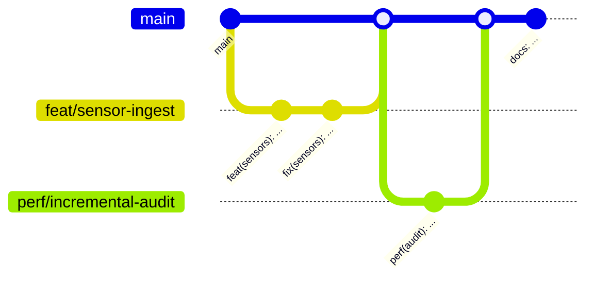

# 04 — Git a standardy pracovního postupu

> Tento dokument neobsahuje zdrojový kód aplikace. Uvedené ukázky jsou **zprávy commitů
> a názvy větví**, nikoli kód.

Standardy odvozené z historie původní codebase: **122 commitů**, 27 větví, 8 slučovacích
commitů.

---

## 1. Jazykové pravidlo — a jeho výjimka

V původní codebase platí rozdělení, které musí reimplementace zachovat, protože je
záměrné a drží se napříč celou historií:

| Co | Jazyk |
|---|---|
| **Zprávy commitů, názvy větví, popisy pull requestů** | **angličtina** |
| Uživatelské rozhraní, hlášky, popisky, chybové zprávy | **čeština** |
| Komentáře ve zdrojovém kódu | **čeština** |
| Dokumentace v `docs/` | **čeština** |
| Identifikátory v kódu (třídy, metody, proměnné) | **angličtina** |

Důvod rozdělení: aplikace je určená českému úřadu a pravidla soutěže vyžadují české
rozhraní, zatímco historie verzí má být čitelná pro kohokoli a nástroje kolem gitu
pracují lépe bez diakritiky.

---

## 2. Konvence commitů

Formát podle **Conventional Commits**:

```
<typ>(<rozsah>): <předmět>

<tělo — volitelné>

<patička — volitelná>
```

### 2.1 Typy

Použité typy a jejich reálné zastoupení v historii:

| Typ | Počet | Kdy se použije |
|---|---|---|
| `feat` | 57 | Nová funkce viditelná uživateli nebo nové API |
| `docs` | 12 | Dokumentace, README, snímky obrazovky |
| `fix` | 8 | Oprava chybného chování |
| `chore` | 5 | Údržba, sjednocení, úklid bez změny chování |
| `perf` | 3 | Změna kvůli výkonu |
| `build` | 2 | Sestavení, kontejnery, závislosti |
| `style` | 1 | Formátování bez vlivu na chování |
| `refactor` | 0 | Přepis bez změny chování — povolený, v historii nevyužitý |
| `test` | 0 | Testy — povolený, v historii nevyužitý |

### 2.2 Rozsah

Rozsah je **nepovinný**, ale u cílené změny se uvádí. Dovolené hodnoty odpovídají
částem systému, nikoli adresářům:

```
web · api · core · reports · research · ui · tour · tools · sensors
audit · seed · security · opendata · mqtt · map · login · iqrf
docker · db · buildings
```

Commit, který mění víc oblastí najednou, rozsah **vynechá** — například
`feat: device pairing, building edits, energy contracts and demo devices`.

### 2.3 Předmět

- **Přítomný čas, oznamovací způsob** — „draw the outline", ne „drew" ani „drawing".
- **Malé počáteční písmeno**, bez tečky na konci.
- Popisuje **výsledek pro uživatele**, ne provedenou operaci.
  Správně: `fix(buildings): draw the outline when the editor opens over a loaded map`.
  Špatně: `fix(buildings): move drawOutline call`.
- Doporučená délka **do 72 znaků**. V historii se vyskytuje až 100 znaků;
  pro nový projekt se stanovuje tvrdý limit **72**.

### 2.4 Tělo

Tělo se píše u každé netriviální změny — v historii má tělo většina commitů.
Dvě používané formy:

**Odrážkový seznam** u commitu, který přináší víc věcí. Každá odrážka začíná oblastí
a dvojtečkou, zalomení na 72–76 znaků:

```
- Sensors: pair new IQRF gateways via a shared provisioning account and
  sticker password, bond nodes in range, nearby devices panel
- Buildings: managers add their own building (RUIAN address suggest),
  edit outlines and override area/floors/year for the loss calculation
- Migrations: AddFacilityContracts, AddDemoDevices, AddBuildingEdits
```

**Souvislý odstavec** u opravy — nejdřív **proč to bylo špatně**, pak co se změnilo:

```
The outline from the API could arrive after the editor layers were added,
so opening the editor showed no outline or handles. The edit stage now
draws the current ring once it starts.
```

> **Závazné pravidlo pro opravy:** tělo commitu typu `fix` musí popsat **příčinu**,
> ne jen zásah. Z historie musí jít poznat, proč chyba vznikla.

### 2.5 Patička

Commity nesou patičku s připsáním spoluautorství. Formát:

```
Co-Authored-By: <jméno> <e-mail>
```

Pokud práce řeší evidovaný úkol, přidává se řádek `Refs: #<číslo>`;
pokud ho uzavírá, `Closes: #<číslo>`.

Zlom zpětné kompatibility se značí vykřičníkem za rozsahem (`feat(api)!: …`)
a řádkem `BREAKING CHANGE: <popis>` v patičce.

---

## 3. Větvící strategie

### 3.1 Model

Jediná dlouhodobá větev **`main`**. Veškerá práce probíhá v krátkožijících
tematických větvích, které se po dokončení **slučují do `main` slučovacím commitem**
(v historii je 8 skutečných slučovacích commitů, zbytek byl převinut).



### 3.2 Pojmenování větví

```
<typ>/<krátký-popis-s-pomlčkami>
```

Typ je **stejná množina jako u commitů**. Popis je v angličtině, malými písmeny,
slova oddělená pomlčkou, bez diakritiky, **2–4 slova**.

| Vzor | Skutečné příklady z historie |
|---|---|
| `feat/…` | `feat/virtual-gateways`, `feat/open-data-api`, `feat/contract-registry`, `feat/district-bubbles`, `feat/sensor-tour` |
| `fix/…` | `fix/mqtt-security`, `fix/loss-from-measurements`, `fix/map-interactions`, `fix/ai-rate-limit-secrets` |
| `perf/…` | `perf/incremental-audit` |
| `chore/…` | `chore/ui-consistency`, `chore/hide-building-section` |
| `docs/…` | `docs/analyza-napady`, `docs/ideas-status` |

**Jedna větev = jedna ucelená věc.** Větev `feat/virtual-gateways` nesmí obsahovat
nesouvisející opravu mapy — ta patří do `fix/map-interactions`.

### 3.3 Pravidla

1. Větev se zakládá **z aktuální `main`**.
2. Do `main` se nikdy necommituje přímo — kromě dokumentace a oprav, které nemění chování
   (v historii se tak chovají commity typu `docs`).
3. Větev žije **nejvýš několik dní**. Dlouhožijící větev se stává zdrojem konfliktů.
4. Před sloučením se větev **sesynchronizuje s `main`** (přeskládáním nebo sloučením).
5. Po sloučení se větev smaže.

---

## 4. Kritéria hotovo (Definition of Done)

Práce se nepovažuje za hotovou, dokud **všechny** body neplatí.

### 4.1 Backend

| # | Kritérium | Jak se ověří |
|---|---|---|
| 1 | Řešení se přeloží **bez chyb a bez nových varování** | Sestavení v režimu Release |
| 2 | Nullable kontext je respektován — **žádné potlačení varování operátorem `!`** bez komentáře, proč je to bezpečné | Kontrola při čtení změny |
| 3 | Testy domény procházejí | Spuštění testovacího projektu |
| 4 | Každá změna schématu má **migraci** a migrace je pojmenovaná podle obsahu | Přítomnost souboru migrace ve změně |
| 5 | Nový případ užití je **vlastní vertical slice**, ne metoda přidaná do existujícího handleru | Kontrola struktury |
| 6 | Doménové pravidlo je vynucené **v entitě**, ne v handleru | Kontrola struktury |
| 7 | Chybové hlášky viditelné uživateli jsou **česky** | Kontrola textů |
| 8 | Žádné tajemství v repozitáři — nové tajemství se přidává do vzorového souboru prostředí s fiktivní hodnotou | Kontrola změny |

### 4.2 Frontend

| # | Kritérium | Jak se ověří |
|---|---|---|
| 1 | Typová kontrola projde **bez chyb** (`strict` je zapnutý) | Překlad TypeScriptu |
| 2 | Linter projde bez chyb | Spuštění linteru |
| 3 | Produkční sestavení projde | Sestavení aplikace |
| 4 | **Žádný typ `any`** — pokud tvar dat není známý, popíše se v `types/` | Kontrola změny |
| 5 | Nová barva, rozměr nebo zaoblení pochází **z tokenu**, ne z pevné hodnoty | Kontrola proti dokumentu `03` |
| 6 | Interaktivní prvek má **viditelný stav zaměření klávesnicí** | Průchod klávesnicí |
| 7 | Nová animace je vypnutá při nastavení „omezit pohyb" | Kontrola změny |
| 8 | Texty rozhraní jsou **česky** | Kontrola textů |
| 9 | Komponenta je serverová, pokud nepotřebuje interaktivitu | Kontrola struktury |

### 4.3 Společné

| # | Kritérium |
|---|---|
| 1 | Změna je pokrytá commitem podle konvence z části 2 |
| 2 | Tělo commitu u opravy vysvětluje **příčinu** |
| 3 | Pokud změna mění chování pro uživatele, je promítnutá do dokumentace v `docs/` |
| 4 | Pokud změna přidává datový zdroj, je uvedený v panelu zdrojů dat — **aplikace musí odkazovat na použitá otevřená data** |
| 5 | Pracovní strom je po dokončení čistý — žádné rozpracované soubory mimo commit |

> **Zjištění z analýzy:** poslední bod je v původní codebase porušený — pracovní strom
> obsahuje 112 nezacommitovaných změn včetně celého modulu průvodce. Reimplementace
> má tento stav napravit, ne zopakovat.

---

## 5. Nástroje kontroly kvality — doporučení nad rámec původního stavu

Původní codebase **nemá konfiguraci formátovače ani `.editorconfig`**. To je skutečný
stav, nikoli opomenutí analýzy. Pro reimplementaci se stanovuje:

| Oblast | Nástroj | Nastavení |
|---|---|---|
| Formátování C# | `.editorconfig` | Odsazení 4 mezery, UTF-8, LF, složené závorky na novém řádku (styl původní codebase) |
| Formátování TS/TSX | Prettier | Odsazení 2 mezery, dvojité uvozovky, středníky, šířka 100 |
| Statická kontrola TS | ESLint s konfigurací pro Next | Beze změny proti původnímu stavu |
| Kontrola před commitem | Volitelná | Překlad typů + linter nad změněnými soubory |

---

## 6. Rytmus práce pro reimplementaci

Protože reimplementaci provádí autonomní agent po milnících (viz dokument `05`),
platí navíc:

1. **Jeden milník = jedna větev** pojmenovaná `feat/milestone-<číslo>-<popis>`.
2. Na konci milníku **jeden slučovací commit do `main`** se souhrnným tělem
   ve formě odrážkového seznamu.
3. Mezi milníky se **nikdy nepracuje na dvou větvích současně**.
4. Každý milník končí čistým pracovním stromem — nic rozpracovaného.
