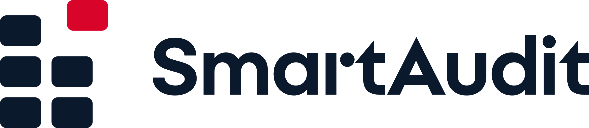

# Logo SmartAudit



**Myšlenka — „Okno, kterým uniká teplo“.** Fasáda šesti oken; jedno vyjíždí ven. Je to místo, kde kraj ztrácí
teplo, a právě to SmartAudit najde. Značka nese sdělení *„Méně tepla oknem. Víc peněz pro kraj.“* Stojí samostatně —
bez přípony KHK a bez loga kraje (verze 1.1, 29. 9. 2026); jediný červený akcent je vysunuté okno.

Pravidla použití: **[SmartAudit-manual-loga.pdf](SmartAudit-manual-loga.pdf)** (2 strany A4 — verze, ochranná zóna,
minimální velikosti, barvy, symbol samostatně, pozadí, zákazy).

## Soubory

| Složka | Obsah | Kdy použít |
|---|---|---|
| `master/` | Zdrojové SVG: `horizontal`, `stacked`, `symbol`, `symbol-small`, `wordmark` + varianty `-on-dark`, `-black`, `-white` | Web, aplikace, vývoj, další úpravy |
| `print/` | Vektorová PDF všech verzí | Tiskárna, reklamní předměty |
| `png/` | Průhledná PNG (lockupy 2400 px na šířku, symboly 1024 px) | Word, PowerPoint, e-mail |
| `web/` | `favicon.svg` (sám se přepne pro tmavý režim prohlížeče), `favicon.ico` (16/32/48), `apple-touch-icon.png`, `icon-192/512.png`, `maskable-512.png`, `site.webmanifest`, `head-snippet.html`, ikona aplikace 1024 px | Nasazení do Next.js aplikace |
| `varianty/` | Symbol černý, bílý, navy, čtvercový avatar (SVG + PNG 512/1024) | Razítka, sociální sítě |
| `prezentace/` | `smartaudit-logo-board.html` + `slides/` (deska s ukázkami), `kontexty.png` (postranní panel, hlavička PDF auditu, QR cedulka, úvodní stránka) | Představení značky |
| `koncepty/` | Přehled tří konceptů z prvního kola (A zvolen) | Historie rozhodnutí |
| `zdroje/` | Skripty, které všechno výše generují | Změny geometrie a nové exporty |

## Konstrukce

- Symbol na plátně 256, mřížka 8: okna 64 × 48, poloměr 10, mezery 16; vysunuté okno posunuté o (+24, −24).
  Kresba je o 4 jednotky vlevo a nahoře od středu — optické vyvážení vysunutého okna.
- **Malý řez** (`symbol-small`, favicon, ≤ 24 px) je samostatná kresba na pixelové mřížce 16 × 16: okna 5 × 3 px,
  ostré na 16 px (hlavní kresba by se na 16 px rozmazala).
- **Verze na tmavé**: okna ztenčená o 1,5 jednotky (bílá na tmavé opticky „bobtná“) a světlejší červená `#E63946`
  (`#D90429` má na navy jen kontrast 3,4 : 1).
- Slovo SmartAudit: Hradec Bold převedený na křivky, kerning přes HarfBuzz, prostrkání −12/1000 em.
  V horizontální verzi je výška verzálek 0,44 výšky symbolu
  a mezera symbol–slovo = 1 šířka okna.

## Barvy

| | HEX | RGB | CMYK (přibl.) | Pantone (nejbližší) |
|---|---|---|---|---|
| Navy kraje | `#0B192C` | 11 25 44 | 75 43 0 83 | ≈ 5395 C |
| Červená kraje | `#D90429` | 217 4 41 | 0 98 81 15 | ≈ 199 C |
| Červená na tmavé | `#E63946` | 230 57 70 | 0 75 70 10 | ≈ 1788 C |

## Provedené testy

- Render a vizuální kontrola všech verzí (Chrome), velikosti 16 / 24 / 32 / 64 px, světlé i tmavé pozadí.
- Jednobarevná verze: myšlenka drží posunem okna i bez červené.
- Kontrast: navy na bílé 17,6 : 1; červená na bílé 5,3 : 1; `#E63946` na navy 4,2 : 1.
- `svg_audit`: bez živého textu, rastrů, filtrů a tahů; 96–99/100 (zbývající poznámky: optické odsazení symbolu
  je záměrné; horizontální lockup je široký → proto skládaná verze a samostatný symbol).
- PDF v `print/` ověřena jako čistě vektorová (0 vložených obrázků).
- Odlišení v kategorii: žádné klišé oboru (dům s listem, blesk, teploměr, Wi-Fi vlny); mřížka 2 × 3 s vysunutým
  dílkem se liší od mřížek 2 × 2 (Microsoft).

## Otevřené body

1. **Licence písma Hradec** (© 2020 Tomáš Brousil, All rights reserved) — ověřit u kraje / autora, zda smí být
   použito v logu produktu. Při zamítnutí je potřeba nahradit slovo v `zdroje/kit.py` jiným písmem a přegenerovat.
2. **Rešerše ochranných známek** — nebyla provedena; doporučena před veřejným použitím.
3. CMYK a Pantone jsou převody z RGB — před tiskem ověřit na vzorníku, případně převzít hodnoty z manuálu JVS kraje.
4. ~~Nasazení do aplikace~~ — hotovo 29. 9. 2026: favicony a manifest v `frontend/app/`, logo jako React komponenta
   `frontend/components/brand/logo.tsx` (geometrie převzatá z `master/`), vlastní QR kód `brand-qr.tsx`, hlavička
   PDF auditu (`backend/.../Resources/smartaudit-logo.png`). Při změně geometrie loga je potřeba přegenerovat i `logo.tsx`.

## Jak přegenerovat

Skripty v `zdroje/` čekají vedle sebe složku `kit/` (výstupy vznikají v `zdroje/kit/`) a používají font
`frontend/app/fonts/Hradec-Bold.woff2`. Potřeba: Python 3 s `fonttools`, `brotli`, `uharfbuzz`, `playwright` (Chrome), `pymupdf`.

```bash
python kit.py            # master SVG
python export_print.py   # png/ a print/
python manual.py         # manuál PDF
python kontext.py        # prezentace/kontexty.png
```

Favicony, ikony a varianty vznikly nástrojem `export_variants.py` ze skillu logo-design (ikony aplikace z verze
`symbol-on-dark` na navy dlaždici); `favicon.svg`, `favicon.ico` a `favicon-16/32/48.png` jsou z barevného malého řezu.
